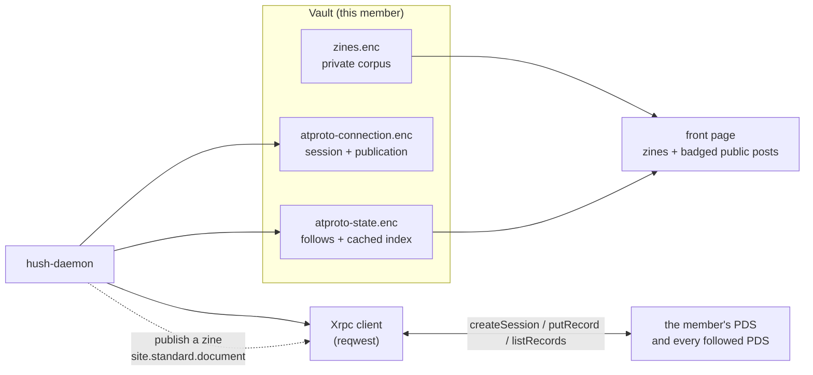

# The public lane — AT Protocol / Standard.site

**Status:** Implemented 2026-10-14. Replaces the Nostr lane (Tasks **11** and **22**) entirely: the
relays, the BIP340 signatures, `npub`/`naddr`/`nevent`, NIP-23 export, NIP-22 comments and the
neighborhoods read lane are gone, along with `crates/hush-articles/`.

**Index:** Task **22** in [`docs/plans/2026-10-04-v1-milestones.md`](../plans/2026-10-04-v1-milestones.md)
(Phase **P**). **Amends Task 11**: the public transport is no longer Nostr and there is no separate
public identity to mint. Pairs with Task **21**
([`zines.md`](zines.md)): the private corpus is **zines**, the public corpus is the **lane**, and
**one front page shows both** behind a switch.

**Goal:** Give a member reach **beyond the membership** without asking them to join a second
network or to hold a key Hush invented. A zine stays private, local-first and end-to-end encrypted;
publishing it writes a **`site.standard.document`** into the member's own **AT Protocol** repo, where
every other client in that ecosystem can read it. The same lane reads other people's documents back
in, from the publications the member chose, and shows them on the same front page behind a control.

**Name:** a private article is a **zine**; a public one is a **post** (the daemon's `AtprotoDocument`).
The feature is the **public lane** in prose and the **ATProto** pane in the control column.

**Non-goals:** a global firehose or an AppView; a follow graph; engagement ranking; short posts
(Bluesky's own `app.bsky.feed.post` is never read or written); remote media; writing to the network
from the private pen name; comments on public documents; a Hush-operated PDS.

---

## 1. Why AT Protocol, and why Standard.site

Nostr's cost was structural: a key Hush minted and the member could lose, a second identity to keep
isolated from the pen name, a relay set to curate, and a comment lane to police. All of it existed so
that a zine could reach readers outside the membership.

AT Protocol changes the shape of that cost rather than the size of the feature:

- **The member already owns the identity.** A DID on a PDS they already have, with an app password
  they can revoke from their own account settings. Hush mints nothing, stores nothing it cannot
  lose, and has nothing to leak when the session is revoked.
- **The reach is real and already populated.** `pckt.blog`, `leaflet.pub` and `offprint.app` agreed
  on the **Standard.site** long-form lexicons, so a post written here is readable there and theirs is
  readable here, with no Hush server in the path.
- **The data model is small and legible.** Two lexicons carry the whole lane (Section 4). A post is
  a title, a body, tags and a date; there is nowhere to put a pen name, a read key or a comment
  thread, which is what makes "nothing private can leave" a property of the shape rather than a rule
  someone has to remember.
- **Reads are pull-only and per-repo.** The lane asks each followed publication's PDS for its
  documents. There is no subscription to a stream and no index in the middle, so this app never
  holds the social graph it refuses to hold.

The one thing it costs, and it is the member's call to make: a published document lands in **their**
repo, so a public zine links this vault to that account. The pen name still covers the bulletin.

---

## 2. Decisions

| # | Decision | Choice |
|---|---|---|
| 1 | Transport | **AT Protocol** (XRPC over HTTPS), not Nostr. Crate: `crates/hush-atproto/` |
| 2 | Lexicons | **Standard.site**: `site.standard.publication` and `site.standard.document` only |
| 3 | Identity | The member's **own DID and PDS**. Nothing minted; an **app password** exchanged for a session |
| 4 | Session | Access + refresh JWT in its own encrypted sidecar (`atproto-connection.enc`), in the Task **6** backup, rotated on write, revoked on sign-out |
| 5 | Egress | The **same proxy the relay uses**: direct when Tor is off, through the SOCKS port when it is on. One switch, not a second |
| 6 | Publication | One `site.standard.publication` per vault at the fixed rkey `self`, so setup replaces the blog rather than starting a second one |
| 7 | Publish | **Explicit, per-post, one-way.** Record key derived from the zine id, so a re-publish replaces in place |
| 8 | Body | Plaintext, from `reads::rich_text_to_text`. The lexicon's field forbids markup, and the conversion cannot smuggle any |
| 9 | First publish | `publishedAt` set once and held; `updatedAt` only after the first write. An edit does not claim the post was written later than it was |
| 10 | Reading list | A curated **follow list**, one publication at a time. A `did` needs nobody's help; a `handle` is resolved against the member's own PDS |
| 11 | Reads | **Pull-only**, `REFRESH_LIMIT = 50` newest per follow, cached encrypted in `atproto-state.enc` |
| 12 | Opening a post | Served from the cache. Opening makes no request, so no PDS learns which article was read |
| 13 | Comments | **The linked Bluesky thread.** Standard.site has no comment record, so the ecosystem puts the conversation on an `app.bsky.feed.post` and points at it from the document's `bskyPostRef`. Read with `app.bsky.feed.getPostThread`, written with `app.bsky.feed.post` and a reply ref. Measured live: 35 of 53 documents carry the link. The sealed zine thread is untouched |
| 14 | The mixed page | One front page; public posts badged `public post`; a switch shows/removes them |
| 15 | Rendering | Public bodies are **plaintext, set as text**. They are never parsed as markup |
| 16 | Overlap | Your published zine, read by another member through the lane, is a **separate public object** — no cross-lane linking or dedupe |
| 17 | Reading a body | `textContent` when present; otherwise `plaintext` collected from the record's `content` tree, and `html` reduced through `hush_atproto::html`. Plaintext either way — see Section 4 |
| 18 | Links kept at ingest | `bskyPostRef` (where the comments are) and `site` (which publication a document belongs to) are both preserved. Dropping `site` made "follow this blog" mean "follow everything this account writes" — the two live follows resolve to **5** distinct publications |
| 19 | Discovery | **One hop from a shipped seed list, no account, no AppView.** Read `app.bsky.graph.follow` out of each seed's own repo, keep the accounts that publish `site.standard.publication`, cache the directory in `atproto-state.enc`. `SEEDS` are **DIDs**, so a crawl needs no resolver and cannot be stopped by a handle that will not resolve. `describeRepo` on the account's own PDS names it. Bounded at 50 follows per seed, 120 accounts probed, 8 in flight. Following from the directory is by `did`, which is what makes it work for a member who never signs up |
| 20 | Pointer documents | A record may be a **pointer** rather than a body: a title, a `description` and a `path`, with the words on the author's own site. The `path` is joined to the publication's `url` at ingest, so the reader has a link instead of a blank page. Measured live: **48 of 105** cached documents were this shape and every one opened as a bare title. Resolved at ingest, never at open time, because opening a page must not reach the network. Left empty rather than guessed when either half is missing |

---

## 3. Architecture

- **The crate is protocol and nothing else.** `hush-atproto` is handed a `Post` and hands back a
  record; what a zine *is* belongs to the daemon and `hush-core`.
- **The client has one constructor.** `Xrpc::new` is the only one the daemon builds, and it is
  handed the SOCKS proxy when the member has the relay on Tor and nothing when they do not. There is
  no clearnet path a route can take by accident.
- **The daemon owns the vault.** The connection, the follow list and the cached index live in
  encrypted sidecars read through the account worker; every route answers **401 when the vault is
  locked**, and the lock is checked *before* anything is sent anywhere.
- **The connection is checked first.** `atproto_connect` reads the vault before it uses the
  credential, so a locked daemon refuses the route rather than relaying an app password to a PDS it
  has no business talking to yet.
- **Reads are per-repo and forgiving.** One unreachable PDS costs its own publication and nothing
  else: `RefreshReport::failed` carries the reason per follow, and the rest of the page stands.

---

## 4. Wire format

**`site.standard.publication`** — the blog a vault's documents are filed under. Written at the fixed
record key `self`.

| Hush concept | Field |
|---|---|
| Masthead | `name` |
| The member's own web address | `url` (normalized: trailing slash trimmed) |

**`site.standard.document`** — one post. The record key is
`sha256("hush-zine-rkey-v1\n" ‖ zine_id)[..16]`, so it is stable across publishes.

| Hush concept | Field |
|---|---|
| Title | `title` |
| Body | `textContent` (**plaintext**; the lexicon forbids markup) |
| A taste of the body | `description` (derived, ~200 chars; the lexicon's optional summary) |
| Sections | `tags` |
| The publication it belongs to | `site` (the publication's `at://` address) |
| First publish | `publishedAt` (RFC3339, set once) |
| Last edit | `updatedAt` (only after the first write) |
| Reader's path | `path` (combined with the publication's `url` to build the web address) |

**Reading the body is not the same as writing it** (added 2026-10-15). When Hush *writes* a
document it uses `textContent`, which is the lexicon's own field and what pckt and offprint use.
But the field is **optional**, and the largest publisher in the ecosystem does not use it: Leaflet
writes a rich `content` tree instead (`pub.leaflet.content` → `pages[].blocks[].block`), and pckt
writes both (`blog.pckt.content` → `items[]` alongside `textContent`).

A reader that looked only at `textContent` showed **every** Leaflet post — and 40 of the 53
documents in the two largest publications — as a headline with nothing under it. So `body_text`
takes `textContent` when the author wrote it, and otherwise walks `content` for `plaintext` strings
in document order. That one rule covers the text, header, blockquote, code and list blocks of both
shapes with no per-block-type table. It is deliberately not a renderer: images, embeds, link cards,
buttons and polls carry their words in fields of their own (`alt`, `title`, `text`) and contribute
nothing, because inventing a plaintext rendering per block type is a markup dialect this crate has
no business defining. The output is plaintext either way, so the UI's "set as text, never parsed as
markup" rule is unchanged.

**Two more shapes, both found by reading the live cache rather than the lexicon** (added
2026-10-15, after "I'm opening some posts and it shows no content just the title").

*An `html` block.* A third client (`co.idno.html`) puts the words of a block in an `html` field
rather than a `plaintext` one: `{"$type": "co.idno.html", "html": "…"}`. Measured live: 2 of 105
documents, both rendering as a bare title. Reduced through `hush_atproto::html`, which is the
converter the zines lane already used — moved down into the crate rather than copied, because
`hush-daemon` depends on `hush-atproto` and a second implementation would eventually disagree with
the first about an unclosed tag.

*A pointer document.* The dominant shape, and the reason the symptom was worth chasing: **48 of
105** cached documents carry **no body at all**. Their keys are
`$type, description, path, publishedAt, site, tags, title, updatedAt` — there is no `textContent`
and no `content`. The words are on the author's own site, and the record is a pointer to them. Two
things had to be true for a reader to have anything to show:

- `description` was **written on publish and never read back**. It is now read at ingest, and is
  what the index row's `preview` falls back to when there is no body. Without it the front page
  showed 50 rows with an empty preview.
- `path` was stored but never joined to anything. `fetch_follow` now reads the account's
  `site.standard.publication` records in the same pass and maps each publication's `at://` address
  to its `url`, so `path` `/the-space-to-breathe` + `url` `https://werd.io` becomes a real address.
  One extra request per follow, and a failure to read it is not a failure of the refresh: the
  documents still read, they just cannot be linked.

The join is **verified against the live network** rather than assumed — `https://werd.io/
the-space-to-breathe` answers 200 — and is left **empty rather than guessed** when the publication
is unknown, the `url` is blank, or the `path` is missing. A wrong link is worse than no link: it
sends a reader somewhere the author never published and the reader cannot tell.

Reading a body is therefore three questions, in order: does the record carry `textContent`; does it
carry a `content` tree with words in it; and does it carry a `path` that resolves to a page. A
record that answers no to all three is genuinely empty, and the UI says so instead of showing a
blank page — see Section 6.

**XRPC calls used.** `com.atproto.server.createSession` / `refreshSession` / `deleteSession`,
`com.atproto.repo.putRecord` / `listRecords`, `com.atproto.identity.resolveHandle`, and the PLC
directory (or `/.well-known/did.json` for a `did:web`) to find a repo's PDS. A **401** on a write
rotates the session once and retries exactly once; a second refusal is a real failure.

---

## 5. Daemon API

Socket-first, thin-UI, following the zines pattern. All routes **401 when locked**.

| Route | Body | Returns / notes |
|---|---|---|
| `GET /api/atproto` | — | The whole pane: `account`, `publication`, `follows`, `documents`, `tags`. Never the password or the tokens |
| `POST /api/atproto/connect` | `{pds, identifier, password}` | Sign in. The **only** route that carries a credential. Refuses a non-`https` PDS before making a request; a different account clears the publication pointer |
| `POST /api/atproto/disconnect` | — | Revoke the session at the PDS, clear the sidecar. The reading list and the cache are kept |
| `POST /api/atproto/publication` | `{name, url}` | Write (or replace) the publication at rkey `self`. `409` before an account is connected |
| `POST /api/atproto/follows` | `{follows: [{did?, handle?, name?}]}` | Replace the whole list. A `did` is taken as given; a `handle` is resolved against the member's own PDS, so it needs a session |
| `POST /api/atproto/refresh` | — | Read every followed publication and merge into the cache. Answers the pane plus `changed` and `failed[]`. An empty follow list is a no-op, not an error |
| `GET /api/atproto/document?uri=` | — | One document **with its body**, from the cache. `404` before it is held |
| `GET /api/atproto/explore` | — | The cached discovery directory: `directory[]` and `crawled_unix` (`0` before the first crawl). Reads the vault, reaches nothing |
| `POST /api/atproto/explore/refresh` | — | Crawl one hop from the shipped seeds and replace the directory. Answers the directory plus `failed[]`. **Needs no session**, which is the point of it |
| `POST /api/zines/{zine_id}/publish` | — | Publish a zine. `409` when not connected, `409` when no publication is set, `404` for a zine this vault does not hold, `400` for a zine it did not write. Answers `published`, `publish_error`, `uri`, `cid`, `rkey`, `url` and the pane either way |

The credential discipline is tested: a connect's answer carries the DID, the handle and the PDS and
**not** the app password or either token.

---

## 6. UI — the mixed front page

- **The page** is one newspaper: masthead, the section strip, a lead, then the runs — over a mixed
  corpus when `Public posts` is on.
- **The switch** lives in the control pane and is a **view control**, like `Mine only`: it shows what
  the vault already holds. It is not the opt-in, because showing a cache reaches nothing. **Refresh**
  is the one control that talks to the network, and it says so.
- **`Public lane…`** opens the setup dialog: connect an account, name the publication, edit the
  reading list. One dialog for the three, because they are one story.
- **The badge.** Every public card and public page carries a `public post` badge; a zine that has been
  published carries `also public`, because its body is now readable by anyone. A reader never has to
  infer which side of the wall a story is on.
- **A public post's page** carries honest copy — public, permanent, not removable, and opening it
  makes no request — then the body **as plaintext**, then the record's `at://` address in full with a
  copy button. There is no thread and no composer.
- **A post with no body says where its body is** (added 2026-10-15). When the record carries no
  words, the page shows the author's own `description` and a `Read it on <host>` button rather than a
  blank page — see Decision 20 and Section 4. The button routes through the same `confirmExternalOpen`
  dialog every other outbound link uses, so the shell is never handed a URL to open without the
  member seeing where it goes. When the publication could not be read and there is no address to
  offer, the page says **that** — a blank page is indistinguishable from a failure, and the member
  has no way to tell which one they are looking at. Measured live: this is the difference between
  **50** front-page rows with an empty preview and **0**.
- **The lead** prefers a private zine whenever one is visible; a public post leads only when the
  visible set has none. The front page is the members' paper first.
- **Publishing** is offered on the zine's own page, only for a zine this vault wrote, behind a
  confirmation that lists what leaves (title, tags, body, first-publish date) and what does not
  (thread, history, pen name, read key).
- **`lib/zinesPage.ts`** composes over a normalized `FrontPageStory` (`zineStory` / `postStory`), so
  the layout rules are answered once for both lanes: `newestFirst` (ties break on id), `leadOf`,
  `badgeOf`, `sectionCounts`, `groupBySection`, `bylineOf`, `byByline`, `publicByline`. Covered by
  `zinesPage.test.ts`.
- **Explore** is the way *in*. A vault with one zine and nothing followed is the state the page starts
  in, and the read lane is curated, so nothing in the app suggested anything. `Explore publications`
  sits in the pane beside the `Public posts` switch — outside the `atprotoShown` branch, because
  hiding discovery behind a switch a new member has no reason to have turned on would hide it from
  exactly the person it is for — and an empty front page offers `Find publications to read` as its
  one way forward.
- **The dialog is built around seeing many publications at once**, which the first version was not.
  Measured against it: 66 rows averaging **269px** meant **two** were visible at a time in a
  **19,000px** scroll, row heights swung **105px–386px** (descriptions run 5–329 characters), **62**
  of the 66 rows carried a primary button, and `via <seed>` was printed **66 times** to convey **2**
  distinct values. Now: a fixed **52px** two-line row with the description clipped, a quiet
  `Follow` (no primary buttons), the list grouped under a sticky `via <seed> · n` heading per seed,
  a filter over name/handle/URL/description, and one line of copy where there were three sentences.
  Re-measured in the browser: **9 rows visible**, scroll **3,503px**, row height flat at 52px.
  Filtering `book` → 4 rows, `zzzz` → the empty note, cleared → 66, with focus and caret kept
  across the re-render.
- **Following from Explore is by `did`**, never by handle, so it works for a member with **no
  account at all** — the `did` needs no resolver. `lib/explorePage.ts` holds that rule (`isFollowing`,
  `toggleFollow`, `groupDirectory`, `rowSubtitle`) with `explorePage.test.ts` over it, because matching
  on a handle would follow the wrong account after a rename and rebuilding the list from the directory
  would drop follows the crawl happened not to find again.
- **A follow is per account, not per publication**, and the row says so in its tooltip. One account
  can host several directory rows (`pckt.blog` hosts 3), so following any one of them reads all of
  them. That is honest to the record — the lane follows repos — but it is surprising otherwise, and
  it is open question 8.

---

## 7. Threat model delta

Recorded in [`THREAT_MODEL.md`](../THREAT_MODEL.md).

| Surface | What it may see | Rule |
|---|---|---|
| Read egress | Each followed PDS learns **which publication was read and by whom** (its own access log); the member's own PDS learns nothing from a read | Pull-only and per-repo, so no index and no AppView accumulates the graph. Routed through the relay's own proxy setting |
| Session | An app password (once) and an access/refresh JWT pair | Encrypted sidecar, in the backup, never in a response or a log; revocable by the member at their PDS without Hush's help |
| Publish | A public, permanent record **in the member's own repo** | Explicit per-post confirmation; the record shape has no field for anything private; the vault↔account link is disclosed in the dialog copy |
| Opening a post | Nothing | Served from the cache; no request is made |
| Public→private linkage | A published zine links this vault to the ATProto account | Stated plainly. The pen name still covers the bulletin; the two are separate objects and are never cross-linked |
| At rest | `atproto-connection.enc` and `atproto-state.enc`, sealed under the vault master key | Cached public content is encrypted for hygiene, not secrecy |

**Honest limits for user-facing copy:** a public post is public, permanent and cannot be
un-published from here; the record is in the member's own account, which is what can edit or remove
it; reading the lane reaches the network only when Refresh is pressed.

---

## 8. Phases and acceptance criteria

### Phase 1 — The crate (protocol only)
- [x] `crates/hush-atproto/`: session (create/refresh/delete, rotation on 401), XRPC client with a
      single constructor that takes the optional SOCKS proxy, PLC/`did:web` resolution, and the two
      Standard.site record shapes. Tested against an in-process stub PDS **and** stub PLC directory,
      so the tests run the real HTTP client rather than a trait standing in for the transport.
- [x] A write that is refused with 401 rotates the session once and retries exactly once, and the
      caller is handed the rotated session.

### Phase 2 — The daemon (vault and routes)
- [x] `Connection` (`atproto-connection.enc`) and `AtprotoState` (`atproto-state.enc`) as vault
      sidecars; `atproto_plc_url` in `ClientConfig` so a mirror or a test can point the lane at its
      own directory.
- [x] The eight routes of Section 5, all 401 when locked, with the lock checked before the credential
      is used.
- [x] `POST /api/zines/{id}/publish`: plaintext body, derived description, sections as tags, held
      first-publish time, derived rkey, and the address minted and recorded **before** the send so a
      failed publish retries at the same address.
- [x] Ten daemon tests over a stub PDS: no account before a connect; the password and tokens stay out
      of the answer; a non-`https` PDS is refused before a request; publish refuses without a connect
      or a publication; the record the PDS is handed carries only the public half; a re-publish
      replaces in place at the same rkey and keeps `publishedAt`.

### Phase 3 — The mixed page
- [x] `Public posts` in the control pane as a view control; the corpus is concatenated in
      `zinesHeld()` and every composition rule reads from there, so a control that hides stories
      cannot leave a strip entry promising stories that are not there.
- [x] The `public post` and `also public` badges; the plaintext body set as text; the address shown in
      full with a copy button.
- [x] `Public lane…` — connect, publication and reading list in one dialog, with the credential's
      handling stated in the copy.
- [x] The publish dialog: what leaves and what does not, then the address, the web address when a
      publication is set, and a retry that sends the same record rather than a second one.

### Phase 4 — Removing Nostr
- [x] `crates/hush-articles/` deleted; the relay read lane, the export bridge, the NIP-22 comment
      lane, `public-identity.enc`, the `npub`/`naddr`/`nevent` surface, `publicThread` /
      `flattenThread` and the neighborhoods routes are gone from code, tests and the frontend.
- [x] `ZineExport` / `export_address` / `record_export` / `export_scopes` dropped from the zine store;
      the summary now carries the **public footprint** (`ZinePublic`: did, uri, cid, first publish,
      last write) and nothing Nostr-shaped.

### Phase 5 — Hardening and docs
- [ ] Publication/follow health in the dialog; per-account proxy override if it is ever needed.
- [ ] `DISTRO_READINESS.md` records the ATProto egress beside the messaging relay and the Tor lane.

### Phase 6 — Reading real publications (2026-10-15)
- [x] `body_text`: `textContent` when the author wrote it, otherwise `plaintext` collected from the
      record's `content` tree. Verified against the live network — 53 documents from `leaflet.pub`
      and `pckt.blog`, of which **40 were rendering with an empty body and now none are**; the walk
      reproduces `textContent` character-for-character on the 13 pckt records that carry both
      encodings, which is the ground truth for the shape.
- [ ] Images, embeds, link cards and buttons contribute no text. Revisit only if a followed
      publication turns out to be mostly those.

### Phase 7 — Explore (2026-10-15)
- [x] `crates/hush-atproto/src/explore.rs`: one hop from a shipped seed list, bounded
      (`FOLLOW_LIMIT` 50 per seed, `CRAWL_CAP` 120 accounts, 8 probes in flight). Reads
      `app.bsky.graph.follow` out of each seed's own repo, then `site.standard.publication` out of
      each account it reaches, and `describeRepo` for the handle. **No AppView**: the follow list is
      the account's own record and the handle comes from the PDS that serves it.
- [x] The handle comes from `com.atproto.repo.describeRepo` on the account's own PDS rather than
      from an index, which keeps discovery inside the same per-repo boundary the read lane holds to.
      `handleIsCorrect` is ignored on purpose.
- [x] The directory is cached in `AtprotoState` (`directory`, `directory_unix`, cap 500) so it is
      encrypted, backed up and restored by machinery that already exists rather than by a second copy
      of it. `GET /api/atproto/explore` reads the vault; only `POST .../refresh` reaches the network.
- [x] Verified against the live network: **66 publications in 5.2 s, 0 failures**, from two seeds.
      Per-publication listing is what makes that number right — `awarm.space` alone hosts five.
- [x] Following from the directory is by `did`, so it works with **no account**; confirmed in the
      handler (`main.rs:5385`) and by the live route.
- [ ] The seeds are hard-coded and the UI does not let a member add one. See open question 10.
- [ ] A publication's icon is recorded as present/absent and never fetched: discovery must not become
      a reason to make a stranger's server serve a hundred images.

---

## 9. What not to build

- A firehose, an AppView, or any subscription to a global stream — the lane is pull-only and curated.
- A Hush-operated PDS.
- A Bluesky **client**: no timeline, no feed, no short posts of our own. A reply on a document's own
  thread is the one `app.bsky.feed.post` this lane touches, and it exists only underneath an article
  the member is already reading.
- A comment record of our own. The conversation lives on the thread the author linked; inventing a
  parallel store would be a second public surface to moderate, and a second place comments could be
  lost.
- Remote media in v1.
- Publishing from the private pen name, or minting any key on the member's behalf.
- Cross-lane dedupe, auto-linking, or merging a public post with the private zine it came from.

---

## 10. Open questions (not blocking)

| # | Topic |
|---|---|
| 1 | **Multiple publications** — one per vault today; a member with two blogs has no way to say so |
| 2 | **Reading a publication without a follow** — a pasted `at://` address is held only after a refresh of the list it is not on |
| 3 | **Dedupe across follows** — a document republished by two follows is keyed by `at://` URI, so it is already one row, but the byline is whichever follow was read last |
| 4 | **`site.standard.graph`** — the newer Standard.site follow/subscription records; adopting them would let a member bring their existing subscriptions instead of typing handles |
| 5 | **Federation of the cache** — whether a member may export/import the cached index |
| 6 | **Block types that carry words elsewhere** — images (`alt`), link cards (`title`/`description`), buttons (`text`) and polls are read as nothing. Not a bug, a stated limit; revisit with a rendering decision rather than a per-type table |
| 7 | **Following by handle still needs a session** — decision 10 resolves a handle against the member's own PDS, so a member with no session cannot add a follow *by name*. Explore narrows this to "cannot type a name": everything it follows is by `did`, so a member with no account can build a reading list from the directory. `com.atproto.identity.resolveHandle` is unauthenticated and `public.api.bsky.app` answers it; the handle's own `/.well-known/atproto-did` answers without a third party but not always (`leaflet.pub` does not serve it, `sambitar.pckt.cafe` does). Still worth closing |
| 8 | **Following a publication, not an account** — `site` is kept now, so the lane *can* tell one blog from another, but the follow list is still keyed by DID. The two live follows resolve to 5 publications, and the crawl found 66 publications across fewer accounts, so one row per publication is the honest unit and the list is not there yet |
| 9 | ~~**No way to discover a publication**~~ — **closed 2026-10-15** by Explore (Phase 7). A member with no account now has a first step. What remains open is below |
| 10 | **The seeds are a curation decision** — `SEEDS` is two DIDs, so one hop reaches two neighbourhoods and no more. Who is reachable at all is now a decision Hush ships rather than one the member makes, and nothing in the UI lets them add a seed or see that the list is short. Two hops would find far more and cost far more; a member-supplied seed would make it their choice rather than ours |
