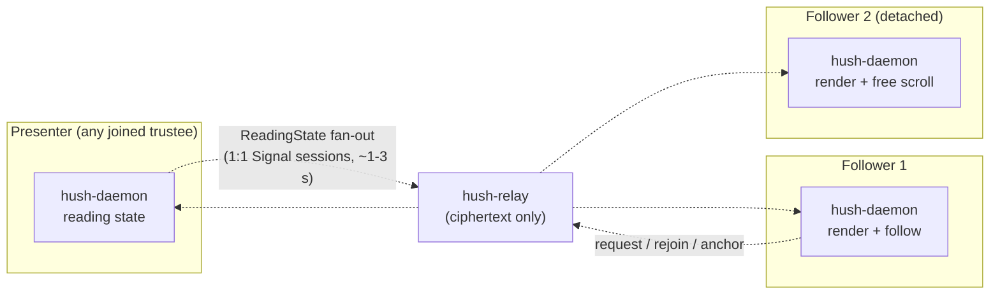

# Conclave Reading Room — shared reading + discussion (planning only)

**Status:** Idea captured 2026-10-12 from discussion. **Planning only** — no code until a phase is
explicitly approved. This is **not grilled to decision level**: the decisions in Section 2 are the
ones stated in the discussion, and everything in Section 3 is genuinely open.

**Index:** New **Task 20** in [`docs/plans/2026-10-04-v1-milestones.md`](../plans/2026-10-04-v1-milestones.md)
(Phase **N**). **Sibling of Task 19** ([`conclave-paper.md`](conclave-paper.md)) — it reuses the
same conclave fan-out and sidecar-store pattern, but shares a **read-only** document and a
**position**, not edited text.

**Goal:** A conclave reads one document together — an ebook, a paper, an article — and talks about
it. One trustee opens the document into the room; every joined trustee sees it; the presenter's
position (chapter / page / paragraph) is shared so the group stays on the same passage; anyone can
detach to scroll ahead or back and rejoin. Discussion happens in the conclave's existing chat, and
can be **anchored to a passage** so "we're arguing about *this* paragraph" is a place, not a guess.
**No streaming, no screen share, no server, no vendor** — the shared state is a position, not pixels.

**Name:** **Reading Room** (product name; lowercase in prose). It competes in the direction of "the
group's reading circle", not a media player.

**Non-goals:** screen sharing / co-browsing (Task **18**); live video or audio of the document
(never — it is text); a Hyperbeam-style virtual browser or any third-party VM; collaborative editing
of the document (that is **Paper**, Task **19**); public rooms; DRM'd content.

---

## 1. Why this is not a watch party

The whole reason a Hyperbeam-style product is hard — and needs a vendor in the media path — is that
it shares **pixels**. This shares **a number**: which passage we are on. That single reduction turns
a media feature into a data feature, and a data feature fits the threat model instead of fighting it.

| | Screen share / virtual browser | Reading Room |
|---|---|---|
| What is shared | pixels (a video stream) | a position (chapter/page/paragraph) |
| Transport | WebRTC media (UDP), or a third-party VM | the existing relay fan-out (ciphertext) |
| New trust party | the hub's host, or the vendor | **none** |
| Cost | bandwidth + encode CPU, scales with viewers | bytes per turn |
| Works over a dumb relay | no (media needs UDP) | **yes** |
| Content | anything on screen | a document, shared once |

Consequence: the Reading Room is **cheaper, simpler, and more private** than either the shared
surface (Task 18) or a rented VM, and it needs no media plane — so it is **independent of Task 17's
postponed video work**. It can land before Task 18.

---

## 2. Decisions captured from discussion (2026-10-12)

| Decision | Choice |
|---|---|
| Primitive | A **shared reading session** over one document — not a call, not a screen share |
| Implementation | **Hush-native.** No third-party service; no streamed pixels |
| Document | One document per session, opened into the room; every joined trustee sees the same thing |
| View model | The room is **driven to a passage** — everyone reads the same thing together (Section 3 #1 for the "forced vs follow" detail) |
| Discussion | Part of the feature; the conclave's existing chat carries it, anchored to a passage |
| Transport | The existing relay fan-out (the **Paper** spine); no media plane, no new server |
| Milestone | Task **20** / Phase **N** |

---

## 3. Open questions (not decided)

1. **"Forced" vs "follow".** The discussion said *forced to view*. A hard lock is right for a guided
   reading and hostile for a discussion (it punishes the slow reader and the person checking a
   claim). Proposed default: **follow the presenter**, with free detach and a "back to the presenter"
   snap; an explicit **lock** mode for a guided read. This mirrors the surface's view-only-by-default
   / host-grant model (Task 18 Section 9) and needs a decision.
2. **Document transfer.** The current conclave file is **inlined** and bounded by
   `MAX_INLINE_FILE_BYTES = 256 KiB` ([`payload.rs`](../../crates/hush-core/src/payload.rs)) — too
   small for most ebooks and PDFs. Options: (a) a dedicated doc-share payload with a larger inline
   cap; (b) an **out-of-band chunked per-trustee transfer** (the vault already has chunked blobs from
   the Torrents work — `put_blob_stream` / `read_blob_stream`); (c) open a document the trustees
   already each hold. Undecided; (b) is the honest answer for real books.
3. **Formats.** Proposed first: **plain text / HTML / EPUB**, reusing `Reads`' reader-mode extraction
   and the `ammonia` sanitizer ([`hush-reads.md`](hush-reads.md)). **PDF**: extract-to-text first
   (the `Reads` fallback), pixel-fidelity later — it is the hard one and may not be worth it.
4. **Discussion persistence.** Live chat is ephemeral today. Anchored **margin notes** that outlive
   the session are attractive and overlap **Paper** / the knowledge-layer annotation store — decide
   whether v1 anchors are live-only or persist.
5. **Voice.** A reading room with voice is a real room, but voice is Task **17** (postponed). Text
   chat makes it usable now; voice is a later add, with the usual IP-exposure limit.
6. **Fast path.** At paragraph granularity the **relay cadence (~1–3 s)** is probably enough. A live
   cursor tracing the presenter would want a DataChannel (Paper's `paper_data.rs`). Deferred until a
   live cursor proves valuable.

---

## 4. Architecture (proposed)



- **Document** — an immutable file stored as an **encrypted vault blob** in every trustee's vault.
  Shared once into the room (transfer is open, Section 3 #2). For a small article it can ride the
  existing conclave file path unchanged.
- **Shared state** — a `ReadingState` (doc ref, presenter, anchor, mode) fanned out per joined
  trustee over the existing 1:1 Signal sessions, exactly like `PaperDelta`. The relay never sees it
  in the clear.
- **Anchor** — a **passage anchor** (chapter id / page / paragraph index), not a pixel offset. Tiny,
  order-independent, and **last-writer-wins** for the presenter — no CRDT is needed (this is the
  deliberate contrast with Paper).
- **Rendering** — the webview renders the document from **local assets only**; the daemon serves the
  document bytes from the vault blob. The webview never fetches from the network (global constraint).
- **Discussion** — the conclave's existing chat. An anchor is attached to a chat message (or a
  margin note) so the conversation points at a place.
- **Transport** — **relay cadence only in v1.** No DataChannel. A live cursor would add one later.

### Components

| Piece | Where | Responsibility |
|---|---|---|
| Reading wire payloads | `crates/hush-core/src/payload.rs` | `ReadingDoc`, `ReadingState`, `ReadingClose` (Section 5) |
| Fan-out + routing | `crates/hush-core/src/account.rs` | `send_conclave_reading_*` beside `send_conclave_message`; route inbound to the reading store |
| Reading store (sidecar) | `crates/hush-daemon/src/reading_store.rs` (new) | Session state + document ref + optional anchors; caps; the `notes_store.rs` pattern |
| Document serving | `crates/hush-daemon/src/main.rs` | Serve doc bytes from the vault blob to the webview (the `materialize` pattern) |
| Daemon endpoints | `crates/hush-daemon/src/main.rs`, `account_worker.rs` | `/api/reading/*` (Section 6) |
| Renderer + follow UX | `apps/hush-tauri/src` | Reading tab in the conclave view; renderer (text/HTML/EPUB), follow/detach, anchor chips |

---

## 5. Wire format (proposed)

New `MessagePayload` variants in `crates/hush-core/src/payload.rs`, fanned out per joined trustee
over their 1:1 Signal sessions exactly like `Conclave`. The relay never sees anything but the
existing opaque ciphertext. Unknown tags must decode to the tolerated `Unknown` (already landed with
Paper).

```rust
pub enum MessagePayload {
    // ... existing ...
    // Task 20 — Reading Room:
    /// The document is open in this conclave. Carries the descriptor (and, for a
    /// small doc, the bytes; a large doc references a blob — transfer is open).
    ReadingDoc { doc: ReadingDescriptor },
    /// Presenter-authoritative position sync.
    ReadingState {
        doc_id: String,
        presenter: String,   // account id; only this account's state is applied
        anchor: String,      // opaque passage anchor
        mode: ReadingMode,   // Follow | Locked | Free
    },
    /// The room closes; the document stays in every vault.
    ReadingClose { doc_id: String },
}

pub enum ReadingMode { Follow, Locked, Free }

pub struct ReadingDescriptor {
    pub doc_id: String,        // random UUID, never exposed to the relay as a name
    pub conclave_id: String,
    pub opener: String,        // account id
    pub name: String,          // display title
    pub format: ReadingFormat, // Text | Html | Epub | Pdf
    pub blob_id_hex: String,   // the vault blob holding the document
    pub size: u64,
    pub created_ms: u64,
}
```

- **Authority mirrors the conclave's:** `ReadingState` is applied only when the sender is the
  presenter named for that `doc_id`; a viewer that sends state is ignored. The opener may hand the
  presenter role to another joined trustee; the room has no convener authority beyond that.
- **No relay change.** `encode_relay_blob` / `decode_relay_blob` are untouched. State messages are
  tens of bytes.

---

## 6. Daemon API (proposed)

Socket-first, thin-UI, following the notes/reads/paper pattern (`account_worker.rs` owns the Vault).

| Route | Body | Returns / notes |
|---|---|---|
| `GET /api/reading/{conclave_id}` | — | Current session (descriptor + presenter + anchor); 404 when no room; **401 when locked** |
| `POST /api/reading/{conclave_id}/open` | `{blob_id, name, format}` | Opens a document into the room; fans out `ReadingDoc` |
| `GET /api/reading/{conclave_id}/doc` | — | Document bytes from the vault blob (the `materialize` pattern; bytes never enter the webview directly) |
| `POST /api/reading/{conclave_id}/state` | `{anchor, mode}` | Presenter only; fans out `ReadingState` |
| `POST /api/reading/{conclave_id}/presenter` | `{account_id}` | Hand the presenter role to a joined trustee |
| `POST /api/reading/{conclave_id}/close` | — | End the room; the document stays in every vault |

---

## 7. Threat model delta

Add to [`THREAT_MODEL.md`](../THREAT_MODEL.md) when implementing:

| New surface | What it may see | Rule |
|---|---|---|
| Relay | Same as today: ciphertext, size, time, queue id, IP. A room adds small, periodic state blobs | **No change** to what is visible; the timing signal is the same class as Paper's |
| Presenter daemon | Each peer's IP only if a DataChannel is added (deferred); no document authority beyond position | **No new trust** in v1 (relay-only, no DataChannel) |
| Document at rest | Nothing in plaintext | The document is an encrypted vault blob, sealed under the vault master key; locked vault = unreadable |
| Third party | **None.** No vendor, no VM, no media server | The point of the task |

**Honest limits for user-facing copy:** a locked vault cannot read the document (live-only, like
calls); the document persists in every trustee's vault once shared (it is not "leaves nothing
behind"); **sharing a document you do not have the right to share is on you** — papers, articles,
and your own documents are clean, commercial DRM'd ebooks are not and will not render.

---

## 8. Phases and acceptance criteria

### Phase 0 — Spec and threat model (this document)

- [ ] Section 3 questions resolved and recorded; `THREAT_MODEL.md` addendum (Section 7).

### Phase 1 — Local reading (no network)

- [ ] `reading_store.rs` sidecar + `/api/reading/*`; lock = 401 everywhere; caps refuse with a reason.
- [ ] Renderer for **text/HTML/EPUB** (local assets only); open a document from a vault blob.

**Verify:** open a document in one vault, restart, it reopens; lock the vault — every route 401s and
the blob on disk is ciphertext; `cargo test -p hush-daemon`.

### Phase 2 — Room fan-out (relay cadence end-to-end)

- [ ] `send_conclave_reading_*` fan-out + inbound routing; presenter state sync; follow/detach UX.

**Verify:** `./scripts/run-two-ui.sh` (extended to three daemons) — one trustee opens a document;
two followers see it and follow the presenter's passage; a follower detaches and rejoins; the relay
DB and every vault hold no document plaintext.

### Phase 3 — Anchored discussion

- [ ] Anchor a chat message (or a margin note) to a passage; jump from the anchor to the passage.

**Verify:** two trustees discuss a specific paragraph; the anchor lands on the right passage for
both; an ended conclave renders the room read-only.

### Phase 4 — Document transfer + PDF (open)

- [ ] Resolve Section 3 #2 (large-document transfer); add PDF (extract-to-text first).

**Verify:** a real ebook (~1–5 MiB) is shared into a room and read by two trustees.

---

## 9. Scheduling

- **Independent of Task 17 / 18** — it is data-only and needs no media plane, so it does **not** wait
  for the postponed video work.
- **After Task 19's spine** is usable (fan-out + sidecar store), which is already partly landed; the
  Reading Room reuses it rather than adding a second sync mechanism.
- **Depends on:** conclave fan-out (done), **5c** encrypted store (done), the tolerant unknown-tag
  decode (landed with Paper). **Reuses** `Reads`' extraction + sanitizer for text/HTML/EPUB.
- **Open dependency:** large-document transfer (Section 3 #2).

---

## 10. What not to build

- Screen sharing, co-browsing, or any third-party virtual browser / VM (Task **18**; rejected as a
  first-party service).
- Video or audio of the document (it is text; streaming it is the wrong shape).
- Collaborative editing of the document (that is **Paper**).
- A second sync engine — reuse the Paper spine; do not invent a reading-specific CRDT.
- A public reading room, or rooms to non-trustees.
- DRM circumvention or a renderer for protected ebooks.
