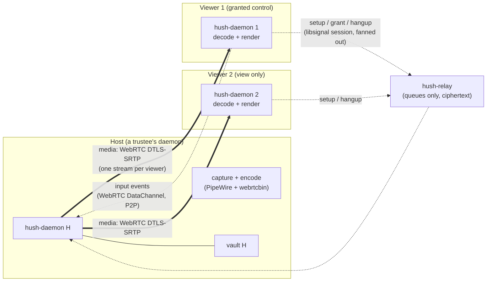

# Conclave shared surface — live screen share / co-browse (planning only)

**Status:** Not implemented. Planning only. No implementation code until a phase is explicitly approved.

**Index:** New **Task 18** in [`docs/plans/2026-10-04-v1-milestones.md`](../plans/2026-10-04-v1-milestones.md) (Phase **L**). **Extends Task 17** ([`member-calls.md`](member-calls.md)) — it reuses the media engine, the control/media plane split, and the daemon-owned peer connection.

**Goal:** A member of a conclave can start a **live shared surface** — a screen, a window, or an application — and the other joined trustees see it live, **end-to-end encrypted**, **peer-to-peer**, with the host's own daemon as the hub. The host may **grant input control** to specific trustees (or to all of them), so a participant can move the pointer and type — the multi-participant-control idea from [neko](https://github.com/m1k1o/neko), done without a server. No Hush server carries media; nothing is recorded; a locked vault ends the session.

**Non-goals (this task):** group voice/video conferencing (that is Task **15.3**, the LiveKit path); a Hush-hosted virtual browser or container (Section 14, "BYO room" — deferred); recording, transcription, or RTMP broadcast (never); control without an explicit grant; sessions that outlive the host's lock; sessions to non-trustees.

**Builds on:** Task **17** media plane (GStreamer `webrtcbin`, control/media split), Task **5h** presence, the conclave fan-out model (per-member 1:1 sessions, convener authority), Task **5c** opaque transport. **Independent of:** mail (**5d**), notes (**16**), articles (**11**), confidential (**10**).

### Decisions locked (2026-10-08)

| Decision | Choice |
|---|---|
| Primitive | A **live shared surface** (one shared screen/window), not a group call. Composes with a future group call; does not replace it |
| Hub | The **host is a participant's daemon**, not a server and not a container. Star topology: host encodes once, fans out one stream per viewer |
| Control model | **View-only by default.** The host grants input control per viewer; grant is revocable and ends with the session. Unlike neko, control is never free-for-all |
| Control-plane transport | New `MessagePayload` variants inside the existing Signal sessions, **fanned out per member** (no group object, consistent with conclaves) |
| Input-event transport | A **WebRTC DataChannel** on the same peer connection (P2P, DTLS), **not** the Signal session — per-pointer-move ratchet messages through the relay would be wrong |
| Media engine | **GStreamer `webrtcbin`**, the same engine as Task 17. Adds screen capture (PipeWire + portal) and low-latency encode |
| Recording | **Never.** Frames are never written to disk. No RTMP, no broadcast |
| Lock during a session | **End the session, revoke all control, zeroize media state** on auto-lock/suspend |
| Milestone | Task **18** / Phase **L** |

---

## 1. Why this is not "self-host neko"

neko is a capable, Apache-2.0, self-hostable **virtual browser / desktop in a container**, streamed over WebRTC to many participants who can all control it. It would answer the literal question ("shared controllable screen for a group") on day one. It is not the default here because a direct port conflicts with what [`DESIGN.md`](../DESIGN.md) / [`THREAT_MODEL.md`](../THREAT_MODEL.md) already commit to:

| Concern | neko default | Hush requirement |
|---|---|---|
| Hub location | A **container on a server** (the operator's host) | No first-party media relay. The hub is a **participant's own daemon** |
| Control | **Everyone controls** by default | **View-only by default**; control is an explicit, revocable grant |
| Room model | A room manager / directory (`neko-rooms`) | No directory. Membership is the **conclave** the peers already share |
| Recording | Session recording and RTMP broadcast | **No recording, ever** |
| Trust shape | A **smart** server with room state and admin credentials | The relay stays a **dumb** ciphertext store; conclave state is convener-authoritative and lives in vaults |

What neko is useful for is the **primitive and the lessons**, both of which this spec adopts:

- **A shared, controllable surface is a distinct primitive** from a call, and worth having. This is the gap neko exposes.
- **Control plane and media plane are separate.** neko signals over a websocket and streams over WebRTC; Task 17 already drew the same split, and this task reuses it.
- **A star with a single hub is how you scale multi-participant without an SFU.** In neko the hub is a container; here it is the host's daemon.
- **A hub is a single point of failure and of trust.** neko accepts that because the hub is the operator's server; here the hub is a person, so control and IP exposure are made explicit (Sections 4 and 7).

**Rejected outright:** adopting neko itself (a container on a Hush-operated host), because it reintroduces the server-hosted hub the threat model forbids. The container *idea* survives only as a **user-supplied** room (Section 14), never first-party.

---

## 2. Hard constraint: this is a video feature, so it is gated on Task 17 Phase 4

Task 17 ships **audio-only first**; **video is a later phase** (its Phase 4, with the video-surface decision still open — [`member-calls.md`](member-calls.md) Section 9 #9). A shared surface is *inherently* video. Two consequences, stated plainly so the schedule is honest:

1. **Task 18 cannot land before Task 17 Phase 4 (video) exists**, because it needs the decode-and-render path the video phase produces.
2. **Task 18 is the strongest reason to do Phase 4.** The first consumer of video in Hush is a shared surface, not a two-way video call. If Phase 4 is scheduled, it should be designed against this use case: a **low-latency, interactive** surface (remote-desktop-like), not a conversational video window. Those have different encoder settings (Section 6).

The WebKitGTK finding from Task 17 Section 2 applies unchanged: the peer connection and the media pipeline live in **`hush-daemon`**, not the webview. The UI is chrome — controls, participant list, "who is controlling" indicator — and the incoming video is rendered on a **native surface** the daemon owns, not in the webview.

---

## 3. Architecture

Two planes, deliberately separated — the same shape as Task 17, extended from one viewer to many:



- **Control plane** — session setup, control grants, and hangup are new `MessagePayload` variants carried in the **existing libsignal 1:1 sessions**, fanned out per member exactly like a conclave message. There is **no relay-side room and no group object**: the host encrypts each control message once per trustee and puts N blobs. Because the SDP (including the DTLS fingerprint) travels inside an authenticated, ratcheted session, the media channel's identity is authenticated end-to-end.
- **Input plane** — live pointer/keyboard events ride a **WebRTC DataChannel** on the same peer connection. This is P2P, ordered, and DTLS-encrypted, and it is the right channel for high-frequency events: routing every mouse move through the Signal ratchet and the relay would add latency and load for no security gain. Authorization is enforced **host-side**: the host accepts data-channel input only from viewers it has granted, and drops it the instant a grant is revoked.
- **Media plane** — WebRTC, DTLS-SRTP, **star**: the host holds one peer connection per viewer and sends one encoded stream to each. No Hush server carries it. Each participant learns the host's IP and the host learns each viewer's IP (Section 4).
- **Ownership** — the host daemon owns capture, encode, the per-viewer peer connections, and the authoritative control-grant state. A viewer daemon owns decode, the render surface, and local input capture (only while granted). The UI calls daemon endpoints only.

### Components

| Piece | Where | Responsibility |
|---|---|---|
| Surface signaling + grant payloads | `crates/hush-core/src/payload.rs` | New `MessagePayload` variants (Section 5) |
| Fan-out routing | `crates/hush-core/src/account.rs` | Send signals to each joined trustee; route inbound signals to the surface manager |
| Surface session state machine | `crates/hush-core/src/surface.rs` (new) | Idle → offering → live → ended; per-viewer connection state; grant table; timeouts |
| Media engine | `crates/hush-daemon/src/media/` (shared with Task 17) | Capture, encode, per-viewer peer connections, decode, render surface, DataChannel |
| Screen capture | `crates/hush-daemon/src/media/capture.rs` | PipeWire screencast via `xdg-desktop-portal`; window/region selection |
| Input injection | `crates/hush-daemon/src/media/input.rs` | Apply granted input events on the host (Wayland/libinput; portal where required) |
| Daemon endpoints | `crates/hush-daemon/src/main.rs` | `/api/surface/*` (Section 8) |
| UI chrome | `apps/hush-tauri/src` | Start/join button in a conclave, participant list, control indicator, "take back control", hangup |

---

## 4. Threat model delta

Add to [`THREAT_MODEL.md`](../THREAT_MODEL.md) when implementing:

| New surface | What it may see | Rule |
|---|---|---|
| Relay (control plane) | Same as today: ciphertext, size, time, queue id, IP | **No change.** Signaling is opaque Signal ciphertext; no media, no room object |
| STUN server | Querying IP + port — no party linkage | Self-hosted, as Task 17. No request logging |
| First-party relay (TURN) | — | **None.** We never relay media, so we are never in a position to see a session graph |
| Host daemon | Each viewer's IP, ICE candidates, and the shared screen contents (it produced them) | **Accepted** — the host chose to share. Stated in copy |
| Viewer daemon | The host's IP and the shared screen contents | **Accepted** — conclave trustees are mutually trusted; WebRTC always reveals IP |
| **Granted controller** | **Input control over the host's machine** | **New capability.** Explicit, scoped, revocable, auto-revoked on lock. Visible indicator on the host. Never default |
| Media on disk | Nothing | Frames are never written; no recording, no temp files |
| Session metadata in vault | Optional session rows (start/end, participants) encrypted under the vault master key | Lock hides them |

**Honest limits to state in user-facing copy:**

- A shared surface reveals the **host's IP to every participant**, and each participant's IP to the host. This is a **larger** exposure than a 1:1 call; it grows with the number of participants. IP-level privacy is deferred to the OS/distro layer or a user-supplied relay (Task 17 Section 7).
- **Control is remote input, not remote code.** A granted controller can move the pointer and type into whatever is on the shared surface; the grant is scoped to the surface and revocable at any moment. It is not a shell and grants no access to the vault.
- The network (ISP) can correlate media timing/size even though it cannot read content.
- A locked host ends the session; a locked vault holds no keys, so a locked peer cannot even read a surface invite.

---

## 5. Wire format (proposed)

Extend [`MessagePayload`](../../crates/hush-core/src/payload.rs) with surface variants. Everything below is inside the existing Signal ciphertext; the relay never sees it. The variants are **fanned out per joined trustee** over their 1:1 sessions, exactly like `Conclave`.

```rust
pub enum MessagePayload {
    // ... existing ...
    // New (Task 18):
    SurfaceOffer {
        session_id: String,
        conclave_id: String,
        kind: SurfaceKind,      // Screen | Window | Region
        sdp: String,
    },
    SurfaceAnswer { session_id: String, sdp: String },
    SurfaceIce {
        session_id: String,
        candidate: String,
        mid: String,
        mline_index: u32,
    },
    /// Host-authoritative. Only the host of `session_id` may send these.
    SurfaceControlGrant {
        session_id: String,
        conclave_id: String,
        grantee: String,        // account id
        input: bool,
    },
    SurfaceControlRevoke { session_id: String, grantee: String },
    SurfaceHangup { session_id: String, reason: String },
}

pub enum SurfaceKind { Screen, Window, Region }
```

- `session_id` is a random UUID generated by the host. It is **never** exposed to the relay.
- The offer SDP is carried in `SurfaceOffer` to avoid an extra round trip; the answer in `SurfaceAnswer`.
- ICE uses **trickle** (`SurfaceIce`), as in Task 17.
- **Live input events do not appear here.** They ride the WebRTC DataChannel (Section 3), not `MessagePayload`. This keeps the Signal path for low-frequency, authenticated control only.
- **Grant authority:** `SurfaceControlGrant` / `SurfaceControlRevoke` are accepted **only from the host named for that session**. A viewer that sends a grant to another viewer is ignored — the same single-authority discipline the conclave convener already uses for membership (Section 9).
- **Backward compatibility:** older clients that receive an unknown `t` must ignore it cleanly rather than error. `MessagePayload::decode` currently falls back to `Error::Corrupt` for unknown tags; Task 17 Phase 1 already plans a tolerant `Unknown` arm. **Task 18 depends on that same change** — it is not a second change.
- **No relay or wire-format change.** `encode_relay_blob`/`decode_relay_blob` are untouched.

---

## 6. Media engine

Reuse Task 17's **GStreamer `webrtcbin`** choice; add the screen-capture and low-latency pieces.

| Concern | Approach |
|---|---|
| Capture | **PipeWire screencast** through the `xdg-desktop-portal` ScreenCast interface (the sanctioned Wayland path); `pipewiresrc` in the pipeline. A native X11/Wayland fallback is a later concern |
| Encode | VP8/VP9 (or H.264 where a hardware encoder exists). **Tune for interactive latency**, not throughput: no B-frames, small keyframe interval, shallow buffers. A shared surface is remote-desktop-shaped, not video-playback-shaped |
| Fan-out | One peer connection per viewer, one encoded stream each (star). **Simulcast** (encode layers once, each viewer picks) is the optimization when viewer count or CPU demands it; not v1 |
| Decode + render | Viewer side decodes and renders on a **native surface** the daemon owns. This **is** Task 17's Phase 4 video-surface decision — see Section 2 |
| Input | WebRTC **DataChannel** (SCTP over DTLS) carries pointer/keyboard events host-ward; the host injects them (Wayland/libinput, portal where required) |
| Cost | Host CPU/upload scales with viewer count; encoder is the bottleneck. Cap viewers in v1 (Section 7) |

**Same supply-chain posture as Task 17:** pin the plugin set, ignore `GST_PLUGIN_PATH`, ship only the plugins the path needs, and document the package list in [`DISTRO_READINESS.md`](../DISTRO_READINESS.md).

---

## 7. Transport, NAT traversal, and IP exposure

Same rules as Task 17 Section 7 — **self-hosted STUN, no first-party TURN, direct P2P** — with two consequences that are **worse in a group** and must be documented rather than hidden:

- **The host is a single point of failure.** If the host is behind symmetric NAT, **no viewer can connect**. In a 1:1 call only the pair is affected; here one bad network kills the whole session. There is no first-party relay to fall back on in v1.
- **Failure probability grows with N.** Even with a reachable host, each viewer behind symmetric NAT fails individually. A session with N viewers has N chances to fail.
- **Bandwidth is on the host.** Host upload = N × stream bitrate. v1 should **cap video viewers** (a suggested ceiling of ~5 at interactive quality, degrading to low-fps or one-at-a-time beyond) and say so in the UI.
- **IP exposure grows with N.** The host reveals its IP to everyone; every participant reveals theirs to the host. Accepted for conclave trustees, but stated plainly.

**Escape hatches (not v1):**

- A **user-supplied TURN/overlay** (Task 17 Section 7) removes the symmetric-NAT failure at the cost of the relay seeing the graph — on infrastructure the user chose.
- A **user-supplied container room** (Section 14) moves the hub off the host's laptop for large rooms.

Why not "route by ID" to hide IPs: the same reason as Task 17 — an ID is a name, an IP is where the network delivers; any forwarder must know it. Hiding from the peer needs a relay (which then sees the graph); hiding from the relay too needs onion routing (latency). Neither is v1.

---

## 8. Daemon API (proposed)

Follows the existing socket-first, thin-UI pattern in [`main.rs`](../../crates/hush-daemon/src/main.rs):

| Endpoint | Purpose |
|---|---|
| `POST /api/surface/start` | Begin hosting a surface in a conclave (`{ conclave_id, kind }`); triggers the portal capture prompt |
| `POST /api/surface/join` | Join an offered session as a viewer (`{ session_id }`) |
| `POST /api/surface/answer` | (Internal) complete the viewer handshake |
| `POST /api/surface/grant-control` | Host grants/revokes a viewer's input (`{ session_id, grantee, input }`) |
| `POST /api/surface/hangup` | End or leave a session (`{ session_id }`) |
| `GET /api/surface/state` | Host/participant list, per-viewer control state, session status |
| `GET /api/surface/events` | Optional push (SSE) so the UI updates without polling; else fold into the existing 4 s `recv` poll |

### Presence, latency, and lock

- Sessions are **live-only**, consistent with chat (**5h**) and calls (**17**). A locked or offline trustee is not offered a surface.
- The UI drains on `RECV_POLL_MS = 4000` ([`constants.ts`](../../apps/hush-tauri/src/lib/constants.ts)), so an offer can take up to ~4 s to appear. Task 17 Section 9 #7 accepts this for now; the same options (accept / SSE push / relay long-poll) apply.
- **Lock/suspend ends the session immediately**, revokes every grant, and zeroizes capture, encoder, and connection state.

---

## 9. Roles and control model

| Role | Who | May do |
|---|---|---|
| **Host** | The trustee who starts the surface | Capture; grant/revoke control; end the session |
| **Viewer** | Any other joined trustee | See the surface; request control; leave |
| **Controller** | A viewer the host has granted `input` | Send input events over the data channel; otherwise identical to a viewer |

Rules:

- **View-only by default.** Control is never granted implicitly. This is a deliberate departure from neko's free-for-all.
- **The host is the only grant authority**, mirroring the convener's authority over conclave membership. The host need not be the convener.
- **Grants are per-session and revocable.** They end with the session and are dropped on host lock.
- **A grant is visible.** The host sees a persistent "Alice is controlling" indicator with a one-tap **Take back control**; the first grant to any viewer requires a host confirmation.
- **Optional "everyone may control"** for a trusted conclave is a convenience toggle, still explicit and revocable, still off by default.
- **Control is input-only** and scoped to the surface. It grants no vault access and no code execution beyond what the shared surface itself exposes.

---

## 10. Decisions and open questions

| # | Topic | Decision / status |
|---|---|---|
| 1 | **Primitive** | **Resolved:** a live shared surface, not a group call; composes with a future call |
| 2 | **Hub** | **Resolved:** the host's daemon is the hub (star); no server, no container in v1 |
| 3 | **Control model** | **Resolved:** view-only by default; host-granted, revocable, input-only |
| 4 | **Control-plane transport** | **Resolved:** `MessagePayload` variants in the existing Signal sessions, fanned out per member |
| 5 | **Input transport** | **Resolved:** WebRTC DataChannel (P2P), not the Signal session |
| 6 | **Media engine** | **Resolved:** GStreamer `webrtcbin`, shared with Task 17; adds screen capture + low-latency encode |
| 7 | **Recording** | **Resolved:** never; no RTMP, no disk |
| 8 | **Lock during session** | **Resolved:** end session, revoke grants, zeroize on lock/suspend |
| 9 | **Video surface** | **Inherited open** — this task *is* the driver for Task 17 Phase 4's video-surface decision (Section 2) |
| 10 | **Viewer cap** | **Open** — suggested ~5 at interactive quality; final number is a dogfood measurement |
| 11 | **Screen-capture backend** | **Open** — PipeWire/portal first; X11 fallback and per-compositor quirks decided in the spike |
| 12 | **Input injection backend** | **Open** — Wayland/libinput vs portal RemoteDesktop; decided in the control spike |
| 13 | **Group voice alongside a surface** | **Open** — whether a surface session may also carry conclave voice (would reuse Task 17 audio); keep the door open |
| 14 | **Milestone** | **Resolved:** Task **18** / Phase **L**, after Task **17** Phase 4 |
| 15 | **"BYO room" container** | **Deferred** — Section 14; never first-party |

---

## 11. Phases and acceptance criteria

### Phase 0 — Spec and threat model (this document)

- [x] Decisions in Section 10 resolved and recorded (2026-10-08).
- [ ] `THREAT_MODEL.md` addendum: host/viewer IP exposure in a group, control as a new capability, no-recording rule.
- [ ] Confirm the video-surface decision from Task 17 Phase 4 covers a **low-latency interactive** surface, not only conversational video.

### Phase 1 — Signaling plumbing (no media)

- [ ] New `MessagePayload` surface variants + tolerant `decode` for unknown tags (**shared with Task 17 Phase 1**).
- [ ] Surface session state machine in `hush-core` with timeouts (offer timeout, viewer join/leave, host gone).
- [ ] `/api/surface/*` endpoints; UI start/join/hangup chrome in the conclave view.
- [ ] A host and two viewers exchange offer/answer/ICE and reach a terminal state with **fake** peer connections (no capture yet).

**Verify:** `./scripts/run-two-ui.sh` (extended to three daemons) — Alice starts a surface in a conclave; Bob and Carol see the offer, join, and leave; session ends cleanly for all.

### Phase 2 — One-viewer screen share (view-only)

- [ ] **Spike first:** prove PipeWire/portal capture + `webrtcbin` encode + a real screen reaching one viewer before the rest commits. Fall back or adjust the capture backend if not viable.
- [ ] Host captures the screen, encodes, sends to one viewer; viewer decodes and renders on the native surface.
- [ ] Interactive-latency tuning; clean teardown (no leaked pipeline/threads).

**Verify:** One host, one viewer on a LAN see the host's screen live; no frames written to disk; `relay.db` contains no surface plaintext; a symmetric-NAT case fails cleanly with a clear message.

### Phase 3 — Control grant + input plane

- [ ] Control-grant/revoke payloads, host-authoritative, with the visible indicator and "take back control".
- [ ] WebRTC DataChannel for input; host-side authorization enforced (input from a non-granted viewer is dropped).
- [ ] Input injection backend (Section 10 #12) implemented and tested.

**Verify:** Bob is granted control and drives the host's pointer/keys; Carol (not granted) cannot; revoke takes effect immediately; host lock ends the session and revokes.

### Phase 4 — Multi-viewer and hardening

- [ ] Star fan-out to N viewers; viewer cap enforced and surfaced in the UI.
- [ ] Bandwidth/CPU behavior at the cap documented; degrade path chosen (low-fps vs one-at-a-time).
- [ ] Lock/suspend zeroizes all session and media state; a locked host ends every viewer's session.
- [ ] GStreamer plugin pinning enforced; distro-readiness items (Section 12) closed.

**Verify:** A host and the capped number of viewers hold a session; each granted viewer can control and each revocation is immediate; lock mid-session ends it for everyone; a planted plugin path is refused.

### Phase 5 — Polish

- [ ] Window/region capture selection UX; per-viewer join/leave toasts.
- [ ] Error states (ICE failed, host gone, NAT-limited) with actionable copy.
- [ ] Optional: conclave **voice alongside the surface** (Section 10 #13), reusing Task 17 audio.

---

## 12. Distro-readiness impact

Per [`DISTRO_READINESS.md`](../DISTRO_READINESS.md):

- **New runtime dependencies:** the `xdg-desktop-portal` **ScreenCast** and (for injection) **RemoteDesktop** interfaces; PipeWire; GStreamer encode plugins (`vp8`/`vp9`/`x264` where available); the input-injection backend chosen in Section 10 #12.
- **Second egress:** the same self-hosted **STUN** as Task 17. No new server, no media port on the VPS.
- **Sandbox / systemd:** the daemon already needs PipeWire access for calls (Task 17 Section 11); add the **portal** connection and any input-injection device/socket access, and document the exceptions in the shipped unit.
- **No plaintext on disk:** frames are never written; only optional encrypted session metadata in the vault.
- **Permissions UX:** first-start screen-capture permission flow through the portal, with a clear "why"; control injection permission stated explicitly before the first grant.
- **Config surface:** reuse `config.rs` (`ClientConfig`); no second config system for capture or ICE (DR-14).

---

## 13. Scheduling

- **Do not start before Task 17 Phase 4 (video).** A shared surface is a video feature (Section 2). If Phase 4 is reprioritized, it should be **designed against this use case**.
- **Phase 1 can land with Task 17 Phase 1**, because it shares the tolerant-decode and signaling-plumbing work.
- **Phases 2–4** follow Task 17's media spike and the video-surface decision.
- **Group calls (LiveKit)** stay unbuilt and separate; a shared surface does not require an SFU.

---

## 14. What not to build

- First-party TURN, SFU, or media relay (sees the session graph; eats the bandwidth).
- A **Hush-hosted container or virtual browser** (the neko model). The *container idea* survives only as a **user-supplied "BYO room"** — a member or a trusted third party runs the hub, keyed by invite — which is the same trade as Task 17's BYO TURN and is **deferred**, never first-party.
- **Recording, transcription, RTMP broadcast** — permanently out, per [`DESIGN.md`](../DESIGN.md).
- **Free-for-all control** without a grant.
- Sessions that outlive the host's lock, or sessions to non-trustees.
- WebRTC in the webview on Linux (WebKitGTK limitation, Task 17 Section 2).
- A second config system for capture or ICE.
