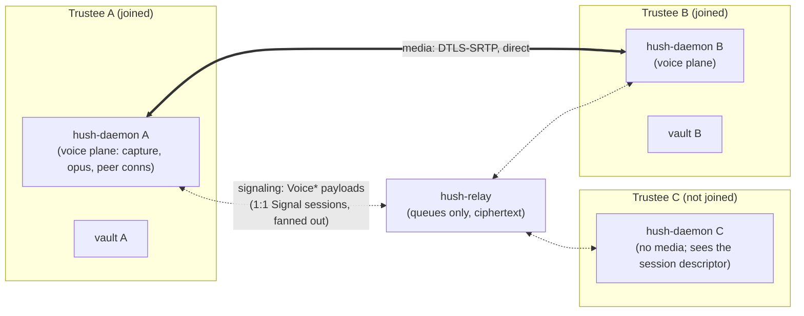

# Conclave voice — group audio in a conclave (planning only)

**Status:** Spec drafted 2026-10-13; **all forks resolved the same day — the user delegated the
decisions** ("do all by your judgement, I will evaluate later"), so they were resolved by **agent
judgment under delegation**, with the reasoning recorded in Section 3 for that review. **Planning
only** — no implementation code until a phase is explicitly approved. The one decision still to be
made *with evidence* is the media-engine spike (Phase 0/2); every other fork is closed.

**Index:** New **Task 23** in
[`docs/plans/2026-10-04-v1-milestones.md`](../plans/2026-10-04-v1-milestones.md) (Phase **Q**). It
fills the gap between Task **17** ([`member-calls.md`](member-calls.md), 1:1 calls only) and the
deferred LiveKit group path (Task **15.3**). Two open doors already point here: Task **18**
§10 #13 ("group voice alongside a surface") and Task **20** §3 #5 ("voice in the reading room").

**Goal:** Trustees in a live conclave can **talk** — end-to-end encrypted, peer-to-peer, with no
Hush server carrying media, nothing recorded, and a locked vault ending the session. Voice is the
third conclave surface: chat (landed), Paper (landed), voice (this task).

**Name:** **conclave voice** (lowercase in prose). The session is a **voice session**; a trustee
who is part of one has **joined**.

**Non-goals (this task):** video (later phase); recording, transcription, or broadcast (never —
[`DESIGN.md`](../DESIGN.md)); PSTN/telephony; voice to or from non-trustees; big-room conferencing
(Task **15.3**, the LiveKit path); voice driven into a shared-surface session (Task **18**
composes later, §2 #7); persistent voice state (the session is live-only and stores nothing); a
chat-record notice for voice events in v1 (§2 #9).

**Builds on:** conclave fan-out (done), the Paper's landed DataChannel spine —
[`paper_data.rs`](../../crates/hush-daemon/src/paper_data.rs) (SDP offers/answers over the existing
1:1 Signal sessions, `ClientConfig::stun_url`, star-with-relay-fallback, lock shutdown) — Task
**17**'s voice threat model (IP exposure accepted, self-hosted STUN, no first-party TURN), and
[`docs/ops/voice-stun-checklist.md`](../ops/voice-stun-checklist.md) (the STUN runbook, written for
Task 17 Phase 2 and reusable here).

---

## 1. Three shapes for group audio, and which one this is

| Shape | Who carries media | Verdict |
|---|---|---|
| **Full mesh** — every joined trustee holds a peer connection to every other | The trustees' daemons, N×(N−1) direct DTLS-SRTP links | **Chosen for v1** |
| **Hub star** — the Paper's shape; a hub re-broadcasts each sender's audio to the others | The hub daemon's uplink is the ceiling; forwarded audio takes double latency | Bigger rooms; deferred behind the cap |
| **SFU** — LiveKit (Task **15.3**) | A smart server terminates DTLS-SRTP | **Rejected for v1** — it sees media and maps the session graph ([`member-calls.md`](member-calls.md) §1 stands) |

Why the mesh fits conclaves and nowhere else in the plan:

- **Conclaves are small and mutually trusted.** The trustee list already rides inside every Signal
  envelope; trustees are the people the threat model already hands everything to. That each trustee
  learns every other trustee's IP is the same accepted exposure as a 1:1 call, one step further —
  and it is stated in copy (Section 5), not hidden.
- **Bandwidth is trivial at conclave scale.** Opus voice is ~32 kbps per stream; at N−1 outgoing
  streams, five trustees cost ~128 kbps uplink. The mesh stops being right where the cap (§2 #3)
  says so, and the hub-star/SFU door stays open behind that cap.
- **No hub to fail.** The Paper's star made the hub a single point of failure for latency and made
  hub succession convener-authoritative. Voice has no equivalent authority need: any joined trustee
  speaks to every other directly, and a trustee leaving costs nothing but their own links.
- **The signaling path already exists per pair.** Every trustee pair shares a 1:1 Signal session —
  the same authenticated channel that carries conclave chat and Paper SDP.

### The engine decision this task inherits (and re-opens)

Task **17** (2026-10-06) chose **GStreamer `webrtcbin`** as the media engine for 1:1 calls,
explicitly rating `webrtc-rs` a fallback because it is "RTP-level only — bring your own codecs and
capture". That decision predates the Paper: the daemon now **already ships `webrtc` 0.21.1** with a
tested, dogfooded connection manager ([`paper_data.rs`](../../crates/hush-daemon/src/paper_data.rs)),
SDP-in-Signal signaling, `stun_url` config, and lock teardown.

Two stacks in one daemon is a real cost; one bespoke media glue layer is a real cost. The resolved
position (§2 #4): **the engine is a spike decision, made once for the whole voice plane** —
whichever engine wins serves both conclave voice (this task) and 1:1 calls (Task **17** Phase 2),
so the two tasks do not grow two different WebRTC stacks. The spike pattern is the Paper's Task 6
Step 1 (prove it, or pivot and log it in [`DEEPSEEKPROBLEMS.MD`](../../DEEPSEEKPROBLEMS.MD)).

- **Reuse `webrtc-rs`** (front-runner): one WebRTC stack in the daemon; the bespoke glue is
  capture/playback (`pipewire-rs` first, `cpal`/ALSA fallback — §2 #5), resample to 48 kHz s16le,
  the `opus` encoder/decoder, packetization, and a jitter buffer — all userspace Rust, no second C
  dependency tree. This is the "bring your own media" cost `member-calls.md` §6 named, scoped and
  bounded.
- **GStreamer `webrtcbin`**: the audited full stack (capture, Opus, RTP, ICE/DTLS, jitter, sinks in
  one audited pipeline) at the price of GStreamer + libnice + plugins beside the existing
  `webrtc-rs`, and a sandbox story with more exceptions (§8 Phase 4).

---

## 2. Decisions resolved (2026-10-13 — delegated; see Section 3 for the reasoning)

| # | Decision | Resolution |
|---|---|---|
| 1 | **Primitive / consent** | A **voice room** per conclave, **explicitly joined** per trustee — not a ring. Join is the consent act; a mic is louder than a message, so there is no passive joining |
| 2 | **Topology** | **Full mesh** of peer connections among joined trustees; no hub, no succession; hub-star and SFU deferred behind the cap |
| 3 | **Cap** | **8 joined speakers** as the starting ceiling; joining at the cap **refuses with a reason** (the `notes_store` pattern); the dogfood measures and may move it |
| 4 | **Media engine** | **One spike, both stacks, one decision for the whole voice plane** (Task 17 Phase 2 included). `webrtc-rs` reuse is the front-runner; the outcome amends member-calls §6 in place, whichever way it goes; a pivot is logged in `DEEPSEEKPROBLEMS.MD` |
| 5 | **Capture backend** (if `webrtc-rs` wins) | **`pipewire-rs` first** — it keeps `PrivateDevices=true` (socket access, not `/dev/snd`), matching the posture the distro docs already prefer; `cpal`/ALSA is the documented fallback |
| 6 | **Authority** | Any joined trustee may **open**; the **opener** may end the session for all; leaving is always per-trustee; the session **auto-ends when fewer than two remain**; `ConclaveEnd` ends any session. No convener gate on opening — membership is already the convener's |
| 7 | **Crypto** | **DTLS-SRTP** with SDP fingerprints authenticated by the Signal session (Task 17 §3's argument, unchanged). **No SFrame in v1** — its attacker class (a compromised media hop) does not exist in a P2P mesh; the recorded revisit trigger is any relayed/BYO-transport mode ever shipping |
| 8 | **Mute and indicators** | Local VAD (your own level meter) only in v1. Remote **mute flags** ride one new low-frequency `VoiceMute` control payload over the existing fan-out — a user action, not a stream, so relay cadence is fine. **No remote speaking indicators** in v1 |
| 9 | **Chat notice** | None in v1. The voice pill/tab state is the surface; a persisted "Alice opened voice" chat record would be a persistence exception for polish — deferred until dogfood misses it |
| 10 | **Shared machinery** | The signaling plumbing lands **once, in this task** (Phase 1); Task **17** Phase 1 becomes a **consumer** of it, the same way member-calls deferred tolerant decode to Paper |
| 11 | **Join latency** | Inherited from Task 17 §13.1: the ~4 s `RECV_POLL_MS` is accepted for dogfood; SSE push later if it feels bad |
| 12 | **Persistence** | **None.** No sidecar, no history rows; a restarted daemon has left the session. Call-history-in-chat-log stays Task 17 §9 #10's open question, not reopened here |
| 13 | **Lock / suspend** | Ends the session for this trustee, tears down every peer connection, zeroizes — the landed `paper_planes_shutdown` pattern applied to the voice plane |
| 14 | **Recording** | **Never.** Media is never written to disk; no temp files |
| 15 | **Milestone** | Task **23** / Phase **Q** |

---

## 3. Reasoning for the delegated decisions (for the user's review)

**Room, not ring (#1).** Conclaves are persistent trust spaces, not moments: the Paper and the
Reading Room both treat conclave membership as standing consent for the surface, gated by an
explicit act. A ring would bolt Task 17's dial-tone model onto a space that already answers "who
is allowed" with the trustee list, and it would fight the ~4 s relay poll at exactly the moment
latency hurts most. The explicit join is the consent.

**Mesh (#2).** Small N, trusted N, trivial uplink, no hub to succeed or fail. The hub-star exists
in the Paper because a document is one flowing object with one rendezvous; audio has no such
object. The cap (#3) is the honest boundary: when a conclave outgrows ~8 speakers the dogfood will
say so, and hub-star/SFU stay behind that door rather than being built speculatively.

**Spike, front-runner `webrtc-rs` (#4, #5).** Member-calls' `webrtcbin` reasoning was written
2026-10-06, before the daemon shipped a working `webrtc-rs` plane. Deciding by spike rather than by
argument keeps the decision evidence-based either way, and making it **once** for 1:1 and conclave
is what prevents two stacks. `pipewire-rs` over `cpal` for capture: the distro record keeps
`PrivateDevices=true` precisely because the DataChannel needed no devices — PipeWire access is a
socket allowance, ALSA is a device one, and member-calls §13.3 already names PipeWire first.

**Authority (#6).** Mirrors the Paper: "creatable by any joined trustee." A convener gate on
opening would add nothing — the convener already governs membership — and the opener's end-for-all
is the same presenter-like authority the Reading Room's opener has. Auto-end at <2 prevents
orphaned one-person rooms.

**DTLS-SRTP, no SFrame (#7).** SFrame protects media against the server that forwards it. There is
no such server in a mesh; adding key fan-out would be a second crypto-adjacent system for no
threat-model gain. The trigger is recorded so the door is deliberate: if media is ever relayed
(BYO TURN), SFrame returns.

**Local VAD, remote mute flags, no remote indicators (#8, #9).** Remote speaking indicators are a
voice-cadence stream of presence — exactly what the Paper's presence precedent refuses to put on
the relay. Mute is a user action, so its flag is low-frequency control traffic, fine at relay
cadence. A chat notice would persist what the design says is live-only; the pill is the surface.

**One slice, here first (#10).** The signaling plumbing for 1:1 calls and conclave voice is the
same machinery with a different roster. Building it twice is the drift member-calls already
anticipated when it deferred tolerant decode to Paper. Task 17 Phase 1 consuming this task's
machinery keeps one state machine in `hush-core`.

---

## 4. Architecture

Two planes, the Task 17/18 split, meshed:



- **Control plane** — `VoiceOpen` / `VoiceOffer` / `VoiceAnswer` / `VoiceMute` / `VoiceLeave` ride
  the existing per-trustee Signal sessions, fanned out exactly like `PaperDelta`. No relay change,
  no room object, nothing new for the relay to learn.
- **Media plane** — one peer connection per *pair* of joined trustees, direct P2P, DTLS-SRTP,
  Opus-only in v1. No hub, no forwarder; every speaker encodes once per listener.
- **Ownership** — the daemon owns capture, encode, the peer connections, and the voice state
  machine. The webview is chrome: join/leave, mute, the level meter, the member list. It is never
  on the media path (the WebKitGTK constraint, Task 17 §2).
- **State** — in-memory only (§2 #12). A restarted daemon has left the session; there is nothing to
  rehydrate, which is why this task adds no sidecar store.

### Components

| Piece | Where | Responsibility |
|---|---|---|
| Voice wire payloads | `crates/hush-core/src/payload.rs` | `Voice*` variants + `VoiceDescriptor` (Section 6) |
| Voice state machine | `crates/hush-core/src/voice.rs` (new) | Idle → open → joined/active → left/ended; join/leave rules, opener authority, cap, timeouts |
| Fan-out + routing | `crates/hush-core/src/account.rs` | `send_conclave_voice_*` beside the Paper senders; route inbound to the voice plane |
| Voice plane (media) | `crates/hush-daemon/src/voice_data.rs` (new) | Peer connections, capture/encode/playout (engine per §2 #4–5), mute, teardown-on-lock — the `paper_data.rs` pattern |
| Daemon endpoints | `crates/hush-daemon/src/main.rs`, `account_worker.rs` | `/api/voice/*` (Section 7) |
| UI chrome | `apps/hush-tauri/src` | Voice tab/pill in the conclave view: open/join/leave, mute, level meter, member list, cap refusal reasons |

---

## 5. Threat model delta

Add to [`THREAT_MODEL.md`](../THREAT_MODEL.md) when implementing:

| New surface | What it may see | Rule |
|---|---|---|
| Relay (control plane) | Same as today: ciphertext, size, time, queue id, IP | **No change.** Voice signaling is ordinary fanned-out Signal ciphertext; the relay carries no media |
| **Joined trustees** | Every other joined trustee's IP and ICE candidates | **Accepted** — the mesh exposes the set, not one peer. Stated in first-call copy, as Task 17 §4 requires |
| STUN server | Querying IP + port, no party linkage | Self-hosted via the existing `stun_url` (no default, `HUSH_STUN_URL` env — already landed with the Paper); runbook: [`voice-stun-checklist.md`](../ops/voice-stun-checklist.md) |
| First-party relay (TURN) | — | **None** in v1; never first-party (same rule as Tasks 17/18) |
| Media on disk | Nothing | Never written; no temp files; no recording |
| Vault | Nothing new in v1 | No call-history rows, no chat notices (§2 #9, §2 #12); the session leaves no trace |

**Honest limits for user-facing copy:** everyone in the session can hear everyone (a room, not a
dial tone); every joined trustee learns every other joined trustee's IP; the network can correlate
media timing/size though not content; a locked or offline trustee is not in the session.

---

## 6. Wire format (proposed)

New `MessagePayload` variants, following the Paper's landed conventions (b64 for binary, SDP in
the offer/answer, no separate ICE variant). Everything rides inside Signal ciphertext; unknown tags
already decode to the tolerated `Unknown` (landed with Paper, 2026-10-12).

```rust
pub enum MessagePayload {
    // ... existing ...
    // New (Task 23):
    /// A joined trustee opened a voice room in this conclave.
    VoiceOpen { session: VoiceDescriptor },
    /// SDP offer with gathered ICE inside — one round trip, the Paper convention.
    VoiceOffer { session_id: String, sdp: String },
    VoiceAnswer { session_id: String, sdp: String },
    /// Local capture muted or unmuted. Advisory: capture stops before the flag
    /// is sent, so audio silence is the truth and this is the label.
    VoiceMute { session_id: String, who: String, muted: bool },
    /// A trustee left (or the session ended). `who` is the account id.
    VoiceLeave { session_id: String, who: String },
}

pub struct VoiceDescriptor {
    pub session_id: String,   // random UUID; never exposed to the relay as a name
    pub conclave_id: String,
    pub opener: String,       // account id — checked against the session roster on apply
    pub started_ms: u64,
}
```

- **Authority mirrors the Paper's:** `VoiceOpen` is applied only when the sender is a joined
  trustee; `VoiceMute` / `VoiceLeave` are applied only for `who == sender`. No convener gate —
  voice has no hub to succeed (Section 1, §2 #6).
- **No relay or wire-format change.** `encode_relay_blob` / `decode_relay_blob` are untouched.
- **Renegotiation:** the Paper avoided a trickle-ICE variant by gathering candidates into the SDP.
  Voice inherits that; if mid-session renegotiation (device change, mute as track replacement)
  proves to need trickle, a `VoiceIce` variant is added then — not before (KISS).

---

## 7. Daemon API (proposed)

Socket-first, thin-UI, the Paper route pattern (`account_worker.rs` owns the vault):

| Route | Purpose |
|---|---|
| `POST /api/voice/{conclave_id}/open` | Open a voice room; fans out `VoiceOpen` |
| `POST /api/voice/{conclave_id}/join` | Explicit consent; dials all joined trustees (`VoiceOffer`); refuses at the cap with a reason |
| `POST /api/voice/{conclave_id}/leave` | Leave (or end, if opener) |
| `POST /api/voice/{conclave_id}/mute` | Mute/unmute local capture; fans out `VoiceMute` |
| `GET /api/voice/{conclave_id}` | Room state: descriptor, joined trustees, self muted/path |
| `GET /api/voice/state` | All voice state for the UI (per conclave) |

- **401 when locked** — every route, the standard worker-lock contract (a locked vault holds no
  keys and must not learn even that a room exists).
- **404 when no session; caps refuse with a reason** — the `notes_store` pattern.
- Voice state is **not** persisted; a daemon restart is a leave.

---

## 8. Phases and acceptance criteria

### Phase 0 — Spec and threat model (this document)

- [x] Section 2 forks resolved and recorded (2026-10-13, delegated — Section 3 holds the reasoning
      for review).
- [ ] `THREAT_MODEL.md` addendum (Section 5).
- [ ] **Engine spike decision made once** (§2 #4): `webrtc-rs` reuse vs `webrtcbin`; capture
      backend per §2 #5 if the front-runner wins. A pivot is logged in
      [`DEEPSEEKPROBLEMS.MD`](../../DEEPSEEKPROBLEMS.MD).

### Phase 1 — Signaling plumbing (no media; awaits explicit approval)

- [ ] `Voice*` payload variants + `voice.rs` state machine in `hush-core` (open/join/leave rules,
      opener authority, cap, timeouts).
- [ ] `/api/voice/*` endpoints; UI chrome: voice pill, open/join/leave, cap refusals.
- [ ] Two daemons exchange open/offer/answer/mute/leave and reach terminal states with **fake**
      peer connections (no audio yet).

**Verify:** `./scripts/run-two-ui.sh` — A opens a voice room in a conclave; B joins, mutes, and
leaves; the room ends cleanly (auto-end at <2 and opener end both exercised); a non-trustee or a
locked vault sees nothing (401/404 contract); `cargo test -p hush-core -p hush-daemon`.

### Phase 2 — Real audio, two trustees (the spike promoted)

- [ ] Engine per Phase 0's decision: capture (`pipewire-rs` per §2 #5), Opus, RTP/DTLS, jitter,
      playout — in the daemon.
- [ ] Two joined trustees hold a real two-way voice conversation **inside a conclave** on a LAN.

**Verify:** two daemons hold a two-way call; mute works and the flag reaches the peer; no media
bytes on disk; `relay.db` and `strings` scans show no call plaintext.

### Phase 3 — Mesh N-way

- [ ] N joined trustees, one peer connection per pair; join/leave/mute converges for everyone; the
      cap refuses with a reason and surfaces it in the UI.
- [ ] Local level meter (VAD); remote mute flags; member list; lock mid-session tears down and
      peers see the leave.

**Verify:** `./scripts/paper-dogfood.sh` pattern — three daemons and a real relay: three trustees
join; each hears the others; mute flags land; one locks and the others see the leave; a fourth
trustee at the cap is refused with a reason; no plaintext on disk anywhere.

### Phase 4 — Hardening and distro readiness

- [ ] Suspend/resume behavior; clean teardown of pipelines/threads (no leaks).
- [ ] Sandbox/systemd: audio access documented (PipeWire socket, or `/dev/snd` if the capture
      fallback is exercised) as the shipped unit's exceptions; dependency pinning per the §2 #4
      outcome.
- [ ] `docs/PROTOCOL.md` voice subsection; `DISTRO_READINESS.md` deps + egress; Task 17/18/20
      cross-references resolved (the doors point here).

**Verify:** documented distro checklists pass; the symmetric-NAT case fails cleanly with a clear
message (no first-party TURN — the Task 17 §7 limitation, restated).

---

## 9. Scheduling

- **Gate:** Phase **C** messaging stability — the same gate Task 17 §12 sets; voice assumes a
  boring 1:1 chat path and live presence (both landed).
- **Phase 1 awaits explicit approval** — this spec is the deliverable of "preparing"; the house
  rule (no code until a phase is approved) stands until the user reviews Section 3.
- **Shared machinery first.** Phase 1's plumbing (variants + state machine + fake peers) is the one
  slice Task **17** Phase 1 will consume; it is written with that consumer in mind and never
  duplicated there.
- **The engine spike is one spike for the whole voice plane** (1:1 and conclave) — run it in Phase
  0/2 here or in Task 17 Phase 2, but never twice.
- **Composes later, not now:** surface voice (Task 18) and reading-room voice (Task 20) wait for
  this to be boring.

---

## 10. What not to build

- A first-party TURN server, an SFU, or any media relay (sees the graph, eats the bandwidth).
- Recording, transcription, or broadcast — permanently out ([`DESIGN.md`](../DESIGN.md)).
- A hub-star re-broadcast or hub succession for v1 (no hub exists in a mesh).
- A second WebRTC stack alongside the one the engine decision picks.
- A second config surface — `ClientConfig::stun_url` is the one place; no TURN fields in v1.
- Voice state persistence (sidecar or chat-log rows) in v1 — including a chat notice for open/join.
- Remote speaking indicators in v1 (a voice-cadence presence stream — the Paper precedent refuses
  it on the relay); local VAD only.
- WebRTC in the webview on Linux (WebKitGTK limitation, Task 17 §2).
- A DHT or public discovery layer (the Tox lesson, Task 17 §1).
