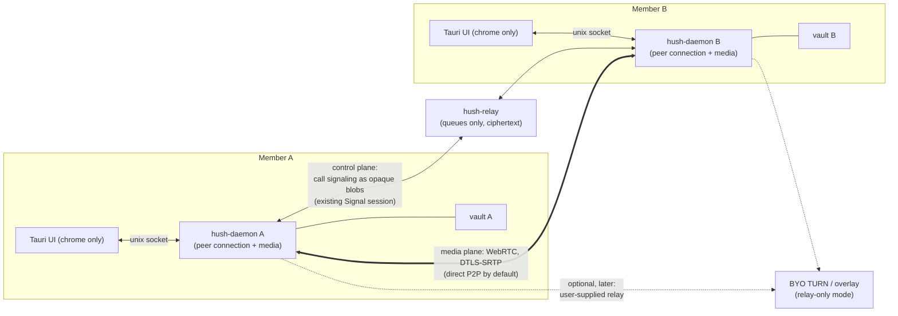

# Member calls — audio/video between contacts (planning only)

**Status:** Not implemented. Planning only. No implementation code until a phase is explicitly approved.

**Index:** New **Task 17** in [`docs/plans/2026-10-04-v1-milestones.md`](../plans/2026-10-04-v1-milestones.md) (Phase **K**).

**Goal:** Two contacts who are both online can start an **end-to-end encrypted**, **direct peer-to-peer** audio (and later video) call from the conversation view. No Hush server carries the media or can read it; the existing relay carries only the authenticated handshake. Each contact necessarily learns the other's IP (WebRTC), which is **accepted** — contacts are mutually trusted. IP-level privacy is deferred to the OS/distro layer or a user-supplied relay (Section 7).

**Non-goals (this task):** group calls / conferencing, PSTN/telephony, recording, screen share, calls to non-contacts, offline/async call setup, scheduling.

**Builds on:** live-chat presence (**5h**), opaque encrypted transport (**5c**), daemon API + worker (**5**), encrypted chat log (**5c.3**). **Independent of:** mail (**5d**), notes (**16**), articles (**11**), confidential (**10**).

**Evaluation input:** [`https://github.com/livekit/livekit`](https://github.com/livekit/livekit) (server) and `livekit/rust-sdks` (client). LiveKit is not rejected on capability — it is deferred as the **group-call** path (see below).

### Decisions locked (2026-10-06)

| Decision | Choice |
|---|---|
| First scope | **Audio-only first**; video is a later phase |
| Signaling transport | New `MessagePayload` variants **inside the existing Signal session** |
| Media engine | **GStreamer `webrtcbin`** (Section 6) — audited standard stack, least custom security-sensitive code; `webrtc-rs` is the pure-Rust fallback |
| Transport / IP posture | **Direct P2P by default** — media goes straight between the two daemons; each contact learns the other's IP, which is **accepted** (contacts trust each other). No Hush server carries media. IP-hiding is a later opt-in via a **user-supplied** relay/overlay, never first-party (Section 7) |
| Lock during call | **End the call and zeroize state** on auto-lock/suspend |
| Ringing latency | **Accept the current ~4 s poll** for now; revisit if it feels bad in dogfood |
| Milestone | **Task 17 / Phase K** |

---

## 1. Why this is not "just self-host LiveKit"

LiveKit is a capable, Apache-2.0, self-hostable **WebRTC SFU** with a Rust SDK and built-in E2EE. It would answer the literal question ("audio/video between members") on day one. It is not the default here because it conflicts with two things already committed in [`DESIGN.md`](../DESIGN.md) / [`THREAT_MODEL.md`](../THREAT_MODEL.md):

| Concern | LiveKit default | Hush requirement |
|---|---|---|
| Media confidentiality | SFU **terminates DTLS-SRTP**, so the server sees plaintext media | Operator/host must not read content. LiveKit **can** fix this with E2EE (SFrame), keys distributed out of band |
| Metadata / social graph | Server learns room IDs, participant identities, join/leave, IPs; **signaling and API calls are not E2EE** | Relay must not map who talks to whom |
| Trust shape | A **smart** media server + JWT API secret that can mint any identity | One **dumb** ciphertext relay; no directory |

For **1:1** — which is the entire v1 scope ("fan-out only… no group object") — an SFU is unnecessary. Two peers can hold an end-to-end encrypted call, and the existing relay already provides an authenticated, encrypted channel to carry the handshake. That yields the strongest threat-model fit at the lowest cost.

**LiveKit returns as the named option for group calls** (Task 15.3 "private messaging rooms"), where a mesh no longer scales and E2EE (keys fanned out over existing sessions) plus random room IDs and pseudonymous identities become worth the second server. This spec keeps that door open; it does not build it.

### Considered and rejected: Tox / ToxAV (2026-10-08)

[Tox](https://tox.chat/) is a mature, fully distributed P2P messenger with working 1:1 audio/video — the obvious "someone already built P2P voice" candidate. It is **rejected** as both a dependency and a media engine. The reasons reinforce the decisions above rather than overturn them.

| Concern | Tox | Hush requirement |
|---|---|---|
| Discovery | Public DHT + volunteer bootstrap nodes; a Tox ID is published so peers can find it | No directory; a public DHT is a queryable social graph ([`THREAT_MODEL.md`](../THREAT_MODEL.md)) |
| Crypto | Custom NaCl (libsodium) protocol; no per-message double ratchet | `libsignal` only; do not invent a ratchet ([`DESIGN.md`](../DESIGN.md)) |
| Media | `ToxAV` — its own Opus/VP8 RTP-ish stack over the Tox connection | WebRTC DTLS-SRTP (`webrtcbin`, Section 6) |
| Identity coupling | Media is bound to `toxcore`'s friend/connection model | Signaling is opaque `MessagePayload` variants inside the existing Signal session; media is a separate plane (Section 3) |
| Infra | Relies on volunteer bootstrap/TCP relays; still flaky behind symmetric NAT | One self-hosted STUN; direct P2P; no first-party relay (Section 7) |

Adopting Tox would mean running a **second identity and crypto stack** (ToxAV is not separable from `toxcore`'s friend model) alongside `libsignal` — double sessions, double presence, double NAT traversal — while adding a DHT we deliberately refuse to run. That is an architectural regression, not a shortcut.

What Tox is useful for is **evidence and lessons**, all of which the plan already encodes:

- P2P voice is easy; **NAT traversal is the hard part.** A decade of hole punching plus TCP-relay fallback still fails behind symmetric NAT — which is why v1 documents that failure cleanly (Phase 2) instead of promising universal connectivity.
- **A public DHT is a social-graph database.** Tox's discovery lets anyone harvest IDs and query presence; this is the anti-pattern the queue model exists to avoid.
- **Bespoke crypto ages badly.** Tox's custom NaCl protocol and its forward-secrecy debates are the case for `libsignal`.
- **IP hiding needs an overlay that sees the graph.** Tox's onion paths/TCP relays are the same trade already recorded in Section 7 (BYO relay/overlay), reached independently.

No Tox code is adopted. **LiveKit remains the named future group-call path; ToxAV is rejected outright.**

---

## 2. Hard constraint: the Tauri webview cannot be the WebRTC client on Linux

This is the single most important finding for this task, and it changes the shape of the work.

Tauri on Linux renders through **WebKitGTK**, and WebKitGTK does **not** expose `RTCPeerConnection` by default. The WebRTC backend is behind an **experimental build-time flag that no distro enables**; the Tauri maintainers state plainly that WebRTC is unsupported on Linux/Tauri and point to CEF integration as the eventual fix.

Evidence (checked 2026-10-06):

- `tauri-apps/wry#85` — *"Nope, it's hidden behind a (experimental?) build-time flag that no distro enabled so far"*; *"With Tauri/webkit no, with Electron/CEF yes."*
- `tauri-apps/tauri#13143` — *"The current browser does not support WebRTC"*; *"ReferenceError: Can't find variable: RTCPeerConnection"*; *"webkitgtk does not yet support webrtc."*
- `base-art.net` — WebRTC is *"not yet enabled by default"* in WebKitGTK; `getUserMedia` capture exists, `PeerConnection` lags.

Consequences:

1. **The peer connection lives in `hush-daemon`, not the webview.** The daemon is already the process that owns keys and does the work; the UI is a thin client. Media capture, encode/decode, ICE/DTLS and playout are daemon-side.
2. **The webview is UI chrome only** — call bar, controls, status, local "speaking" indicator. It must not be on the media path.
3. **This must be verified on the target machine before Phase 2.** If a distro *does* ship WebKitGTK with the experimental flag on, the webview path reopens — but the plan must not assume it.

Note for later: **Android is different.** The Android System WebView supports WebRTC, so an Android client could use the webview path. That is a second code path to decide on when Android lands (Task 8), not now.

---

## 3. Architecture

Two planes, deliberately separated:



- **Control plane** — call signaling (`invite`, `answer`, ICE candidates, `hangup`) rides the **existing libsignal 1:1 session** as new encrypted payloads over the relay queues. No relay changes: the relay still stores opaque Signal ciphertext ([`wire.rs`](../../crates/hush-core/src/wire.rs), Task **5c.1**). Because the SDP (including the DTLS fingerprint) travels inside an authenticated, ratcheted session, the media channel's identity is authenticated end-to-end — a man-in-the-middle would have to break Signal to swap fingerprints.
- **Media plane** — WebRTC, DTLS-SRTP. By default the transport is **direct P2P**: media goes straight between the two daemons, so **no Hush server carries it** and the relay sees no more than it already sees for chat. Each contact learns the other's IP, which is accepted. An opt-in **relay-only** mode via a *user-supplied* relay hides the IP from the contact (Section 7).
- **Ownership** — the daemon owns the call state machine, the media engine, and the devices. The UI calls daemon endpoints only.

### Components

| Piece | Where | Responsibility |
|---|---|---|
| Call signaling payloads | `crates/hush-core/src/payload.rs` | New `MessagePayload` variants (Section 5) |
| Send/receive routing | `crates/hush-core/src/account.rs` | Send signals; route inbound signals to the call manager instead of the chat log |
| Call state machine | `crates/hush-core/src/call.rs` (new) | Idle → ringing → connecting → active → ended; timeouts, busy, hangup |
| Media engine | `crates/hush-daemon/src/media/` (new) | WebRTC peer connection, capture, encode/decode, playout |
| Daemon endpoints | `crates/hush-daemon/src/main.rs` | `/api/call/*` (Section 8) |
| UI chrome | `apps/hush-tauri/src` | Call bar, incoming-call prompt, mute/hangup, status |

---

## 4. Threat model delta

Add to [`THREAT_MODEL.md`](../THREAT_MODEL.md) when implementing:

| New surface | What it may see | Rule |
|---|---|---|
| Relay (control plane) | Same as today: ciphertext, size, time, queue id, IP | **No change.** Call signaling is opaque Signal ciphertext; the relay carries no media |
| **STUN server** | Querying IP + port — **no party linkage** | Self-hosted; a STUN query reveals your IP but not who you are calling, so it adds no graph signal |
| **First-party relay (TURN)** | — | **None in v1.** We do not relay media, so we are never in a position to see a call graph |
| **User-supplied relay (opt-in only)** | Two IPs in one relay session | Only when the user turns on IP-hiding and supplies their own relay/overlay; the graph lands on infrastructure they chose |
| **Peer (contact)** | Your IP address and ICE candidates | **Accepted** — contacts are mutually trusted, and WebRTC always reveals this. Stated in copy |
| Media on disk | Nothing | Media is never written to disk; no recording |
| Call metadata in vault | Call history rows (if enabled) are encrypted under the vault master key, like chat (**5c.3**) | Lock hides them |

**IP-level privacy is deliberately out of the app.** A future Hush OS/distro is where network-level protections (VPN, firewall, onion transport) belong — the app assumes the network it runs on is trusted for IP-level privacy, consistent with [`THREAT_MODEL.md`](../THREAT_MODEL.md) excluding ISP-level analysis.

Honest limits to state in user-facing copy: a direct call reveals your IP to the contact (accepted; IP privacy lives at the OS/distro layer or a user-supplied relay); the network (ISP) can correlate media timing/size even though it cannot read content; a compromised or unlocked device exposes the call as it exposes everything else.

---

## 5. Signaling wire format (proposed)

Extend [`MessagePayload`](../../crates/hush-core/src/payload.rs) with call variants. Everything below is inside the existing Signal ciphertext — the relay never sees it.

```rust
pub enum MessagePayload {
    Text { body: String },
    File { name: String, data: Vec<u8> },
    // New (Task 17):
    CallInvite { call_id: String, media: CallMedia, sdp: String },
    CallAnswer { call_id: String, sdp: String },
    CallReject { call_id: String, reason: String },
    CallIce { call_id: String, candidate: String, mid: String, mline_index: u32 },
    CallHangup { call_id: String, reason: String },
}

pub enum CallMedia { Audio, AudioVideo }
```

- `call_id` is a random UUID generated by the caller. It is **never** exposed to the relay.
- The offer SDP is carried in `CallInvite` to avoid an extra round trip; the answer in `CallAnswer`.
- ICE candidates use **trickle** (`CallIce`) so connect time is not gated by gathering completion.
- Example JSON on the wire (inside ciphertext):

```json
{"t":"call_invite","call_id":"…","media":"audio","sdp":"v=0\r\no=- …"}
{"t":"call_answer","call_id":"…","sdp":"v=0\r\n…"}
{"t":"call_ice","call_id":"…","candidate":"candidate:…","mid":"0","mline_index":0}
{"t":"call_hangup","call_id":"…","reason":"user"}
```

- **Backward compatibility:** older clients that receive an unknown `t` must ignore it cleanly rather than error. `MessagePayload::decode` currently falls back to `Error::Corrupt` for unknown tags; add an `Unknown` arm that is skipped, so a v1 peer and a call-capable peer interoperate for text/file. (Same discipline as the legacy-file path already in `payload.rs`.) — **Already landed**: Conclave Paper (Task 19) added the `Unknown` arm on 2026-10-12, so this task adds only its own call variants and must not duplicate it.
- **No relay or wire-format change.** `encode_relay_blob`/`decode_relay_blob` are untouched.

---

## 6. Media engine options

| Engine | P2P | TURN | Capture + encode/decode | Video render | Verdict |
|---|---|---|---|---|---|
| **GStreamer `webrtcbin`** (`gstreamer-rs`) | yes | yes | yes — `pipewiresrc`/`v4l2src`/`pulsesrc`/`alsasrc`, `opus`, `vp8enc`/`vp9enc`, `decodebin` | `gtkglsink` / native surface | **Chosen** — the audited standard stack; the same one WebKit's own WebRTC backend is built on |
| `webrtc-rs` (`webrtc` v0.20) | yes | yes | **no** — RTP-level only; bring your own codecs and capture | none | **Fallback** — pure-Rust transport, but more bespoke media glue |
| `str0m` | partial | no | no | no | Not a client stack |
| LiveKit `livekit` (rust-sdks) | via SFU | yes | desktop support in SDK | needs a surface | **Future** group-call path (Section 1) |
| **ToxAV** (`toxcore`) | via public DHT + volunteer TCP relays | no (Tox relays only) | Opus/VP8, bound to `toxcore` | client-native surface | **Rejected** — not WebRTC; brings a second identity/crypto stack and a public DHT (Section 1) |

**Decision: GStreamer `webrtcbin` for the client media engine.** Rationale, against the project's "no homemade crypto / use audited components / minimize custom security-sensitive code" stance: `webrtcbin` supplies capture, Opus, RTP, ICE, DTLS-SRTP, TURN, jitter buffering and sinks as one **audited, widely deployed** stack, so we write the least security-critical glue. The alternative, `webrtc-rs`, keeps the transport in memory-safe Rust but leaves us assembling capture → resample → Opus → RTP/SRTP and the reverse ourselves — more bespoke, more places to get wrong.

**Amended in place 2026-10-13 — the shared spike went the other way.** Task **23**'s spec
re-opened this decision for the whole voice plane, and the spike (`crates/voice-spike`, evidence in
[`conclave-voice.md`](conclave-voice.md) §2 #4) resolved it for **`webrtc-rs` reuse**: the daemon
had shipped a working `webrtc` 0.21 plane with the Paper (`paper_data.rs`), and the bespoke glue
proved cheap and measurable — Opus RTP over the daemon's own stack was byte-exact on loopback at
157 µs encode / 28 µs decode per 20 ms frame. One WebRTC stack in the daemon beats shipping
GStreamer beside it. This section's original `webrtcbin` rationale is kept for the record; the
capture-backend fork (PipeWire first, `cpal`/ALSA fallback) lives in Task 23 §2 #5.

Cost and mitigation: GStreamer is a large C dependency with a plugin ecosystem, which is a real attack-surface and supply-chain concern for a privacy app. Mitigations, enforced in Phase 2: **pin the plugin set** (no plugin autoload from environment paths; ignore `GST_PLUGIN_PATH`), ship only the plugins the call path needs, and document the exact package list in `DISTRO_READINESS.md`. If dependency weight is judged disqualifying, `webrtc-rs` is the documented fallback. **Phase 2 begins with a spike** that proves capture + a real two-way call before the rest of the feature commits to the choice.

---

## 7. Transport, NAT traversal, and IP exposure

**Default: direct P2P.** Media goes straight between the two daemons over WebRTC/DTLS-SRTP. No Hush server carries it, and the relay sees only the same signaling metadata it already sees for chat. The one consequence is that **each contact learns the other's IP** — accepted, because a contact is someone you invited and both sides trust each other (Section 4).

- **Self-hosted STUN** (on the relay VPS) for NAT discovery. A STUN query reveals your IP to the server but does **not** link the two parties, so it adds no graph signal. A public STUN server would leak your IP to a third party, so keep it self-hosted.
- **No first-party TURN.** We do not relay media, so we are never in the position of seeing a call graph. If hole-punching fails on a given network (symmetric NAT), the call fails with a clear message — a documented v1 limitation.
- **Opt-in IP-hiding (later), via user-supplied infrastructure.** For users who do not want a contact to learn their IP, a relay-only mode (`iceTransportPolicy: relay`) points at a **BYO TURN server or overlay** — `DESIGN.md`'s "optional self-hosted relay as a checkbox." Then neither we nor the contact sees the IP. A mesh VPN (Tailscale/Headscale/Nebula/iroh-style) is a concrete way to supply that overlay; it is the same trade packaged differently, not a way around it.
- **Deferred to the OS/distro layer.** Hush's future is a distro; network-level IP privacy belongs there, not in the call path. The app assumes the network it runs on is trusted for IP-level privacy.

Why not "route by ID" to hide the IP: an ID is a *name*; an IP is the *address the network delivers to*. Any server that forwards your media must know where to send it, so it sees your IP. Hiding the IP from the peer requires a relay (which then sees the graph); hiding it from the relay too requires onion routing (latency). Neither is v1 — direct P2P is both the simplest and the most philosophy-aligned default.

---

## 8. Daemon API (proposed)

Follows the existing socket-first, thin-UI pattern in [`main.rs`](../../crates/hush-daemon/src/main.rs):

| Endpoint | Purpose |
|---|---|
| `POST /api/call/start` | Begin an outgoing call to a contact (`{ to, media }`) |
| `POST /api/call/answer` | Accept an incoming call (`{ call_id }`) |
| `POST /api/call/reject` | Decline (`{ call_id }`) |
| `POST /api/call/hangup` | End an active call (`{ call_id }`) |
| `POST /api/call/mute` | Mute/unmute local audio (`{ call_id, muted }`) |
| `GET /api/call/state` | Current call state for the UI (idle / ringing / active, peer, media, started_at) |
| `GET /api/call/events` | Optional push (SSE) so the UI is not polling; else fold into the existing 4s `recv` poll |

### Presence and ringing latency

- Calls are **live-only**, consistent with chat (**5h**): the caller checks `contact_is_online` first; an offline contact is not called.
- The UI currently drains the relay every `RECV_POLL_MS = 4000` ms ([`constants.ts`](../../apps/hush-tauri/src/lib/constants.ts)), so a ring can take up to ~4 s to appear. **Accepted for now** (Section 9 #7); if dogfood feels slow, the fix is a daemon→UI push (SSE/websocket) or a shorter idle poll.

---

## 9. Decisions and remaining open questions

| # | Topic | Decision / status |
|---|---|---|
| 1 | **Scope of first ship** | **Resolved:** audio-only first; video is a later phase |
| 2 | **Signaling transport** | **Resolved:** new `MessagePayload` variants inside the existing Signal session |
| 3 | **Media engine** | **Resolved:** GStreamer `webrtcbin`; `webrtc-rs` fallback; Phase 2 spike confirms |
| 4 | **IP disclosure** | **Resolved:** direct P2P default; the contact learns your IP (**accepted**). IP-hiding is a later opt-in via a *user-supplied* relay/overlay; IP privacy otherwise deferred to the OS/distro layer |
| 5 | **First-party relay** | **Resolved:** none in v1 — no first-party TURN, so we never relay media or see a call graph. STUN is self-hosted (no party linkage) |
| 6 | **Lock during a call** | **Resolved:** end the call and zeroize on lock/suspend |
| 7 | **Ringing delivery path** | **Resolved:** accept the current ~4 s poll for now; revisit if dogfood feels slow |
| 8 | **Milestone** | **Resolved:** Task 17 / Phase K |
| 9 | **Video surface** (Phase 4) | **Open** — decide when video starts: native overlay vs webview `<canvas>` vs subsurface |
| 10 | **Call history** | **Open** — recommended: a `Call` row in the encrypted chat log |
| 11 | **Multi-device** | **Open** — device link is a one-time transfer today; calls assume one live device |
| 12 | **Android later** | **Open** — Android WebView supports WebRTC; revisit at Task 8, do not build two paths now |

---

## 10. Phases and acceptance criteria

### Phase 0 — Spec and threat model (this document)
- [x] Decisions in Section 9 resolved and recorded (2026-10-06).
- [ ] `THREAT_MODEL.md` addendum: direct-P2P IP disclosure, no first-party relay, no-recording rule.
- [ ] Verify the WebKitGTK finding on the target machine (WebKitGTK version, `RTCPeerConnection` present or not).

### Phase 1 — Signaling plumbing (no media)
- [ ] New `MessagePayload` call variants (the tolerant `decode` for unknown tags already landed with Paper, Task 19 — do not duplicate it).
- [ ] Call state machine in `hush-core` with timeouts (ring timeout, no-answer, busy).
- [ ] `/api/call/*` endpoints; UI call bar with ringing/answer/reject/hangup.
- [ ] Two daemons exchange invite/answer/ICE and reach a terminal state with a **fake** peer connection (no audio yet).
- [ ] Ringing latency measured (currently bounded by the 4 s recv poll).

**Verify:** `./scripts/run-two-ui.sh` — A calls B, B's UI rings, B rejects, both return to idle; A calls B, B answers, state goes active then hangup.

### Phase 2 — Audio call (direct P2P)
- [ ] **Spike first:** prove GStreamer `webrtcbin` capture + a real two-way audio call on this stack before the rest of the feature commits. Fall back to `webrtc-rs` if the pipeline is not viable.
- [ ] Self-hosted **STUN** for NAT discovery (no party linkage).
- [ ] `webrtcbin` pipeline in the daemon: capture (PipeWire/ALSA), Opus, DTLS-SRTP, playout.
- [ ] Two peers complete a real audio call **directly** on a LAN and across networks where hole-punching succeeds.
- [ ] Mute; device selection; clean teardown (no leaked pipeline/threads).

**Verify:** Two daemons hold a two-way audio call directly; no media bytes written to disk; `relay.db` contains no call plaintext; a symmetric-NAT case fails cleanly with a clear message (documented limitation).

### Phase 3 — Hardening and real networks
- [ ] Calls succeed across two different networks where hole-punching succeeds; the symmetric-NAT limitation is documented and surfaced to the user.
- [ ] Lock/suspend ends the call and zeroizes media/session state.
- [ ] GStreamer plugin pinning enforced (fixed plugin set, no autoload from environment paths).
- [ ] Distro-readiness items (Section 11) closed.

**Verify:** Call across two networks; lock mid-call ends it and the peer sees the call end; a planted plugin path is refused.

### Phase 4 — Video (separate decision)
- [ ] Video surface strategy chosen (Section 9 #9) and implemented.
- [ ] Two-way video call; local preview; degrade to audio on failure.

### Phase 5 — Polish
- [ ] Call history rows in the encrypted chat log.
- [ ] Error states (ICE failed, peer busy, peer locked, network drop) with actionable copy.
- [ ] Optional **relay-only (IP-hiding)** mode via a *user-supplied* relay/overlay (BYO TURN/mesh), never first-party.

---

## 11. Distro-readiness impact

Per [`DISTRO_READINESS.md`](../DISTRO_READINESS.md):

- **New runtime dependencies:** GStreamer core + plugins (`webrtcbin`, `opus`, `vpx`, PipeWire/V4L2/ALSA/Pulse sources and sinks), and `xdg-desktop-portal` for camera/mic permission. Package lists must ship with the app.
- **Second egress:** a self-hosted **STUN** endpoint (no party linkage); optional user-supplied TURN/overlay for IP-hiding. Extends the "single outbound abstraction" rule ([`relay_client.rs`](../../crates/hush-core/src/relay_client.rs)); the config must remain consumable from one client config (future Tor/firewall).
- **Sandbox / systemd:** the daemon needs capture-device and PipeWire socket access; document the required hardening exceptions in the shipped unit (the current unit in `packaging/systemd/` assumes no device access).
- **No plaintext on disk:** media is never written; call metadata only in the encrypted chat log.
- **Permissions UX:** first-call camera/mic permission flow via the portal, with a clear "why".

---

## 12. Suggested scheduling

- **Do not start** until **Phase C** (messaging polish) is stable — calls assume a boring 1:1 chat path.
- **Phase 0** (this spec) can proceed anytime; it is cheap and de-risks the rest.
- **Phase 1** is independent of the media engine and can land as a standalone slice — Section 9's blocking decisions are resolved.
- **Phase 2** begins with the media-engine spike and self-hosted STUN; it should follow confirmation of the WebKitGTK finding on the target machine.
- **Group calls** (LiveKit) stay unbuilt; this spec only keeps the door open.

---

## 13. Infrastructure (v1)

**Status:** guidance recorded 2026-10-08. Nothing here is built. This section fixes *where* each piece of infrastructure lives so implementation does not invent a second config, a second server, or a second egress. It restates and sharpens Sections 6, 7, and 11.

### 13.1 Control / signaling plane

- No new server. Signaling is new `MessagePayload` variants inside the existing Signal session (Section 5); the relay stays a dumb store-and-forward.
- `MessagePayload::decode` skips unknown tags cleanly as of Conclave Paper (Task 19, 2026-10-12) — the `Unknown` arm is in place, so a v1 peer and a call-capable peer interoperate.
- **Ringing latency** is the one real control-plane question. The UI drains on `RECV_POLL_MS = 4000` ([`constants.ts`](../../apps/hush-tauri/src/lib/constants.ts)), so a ring can take ~4 s. Options, cheapest first:
  1. Accept it for dogfood (Section 9 #7) — **the v1 default**.
  2. Daemon→UI push (`GET /api/call/events`, SSE) so the UI updates the instant the daemon has the invite. Local only; does not change relay timing.
  3. Add a relay **long-poll** (`GET /q/{id}?wait=…`) so a ring lands in <1 s without busy-polling. The relay is deliberately request/response-only today (see [`relay-https-checklist.md`](../ops/relay-https-checklist.md)); this is a conscious relay change, not a client tweak.
  4. Shorten the idle poll — most relay traffic, least preferred.
- **Plan:** land Phase 1 with (1); add (2) with the UI call bar; adopt (3) only if dogfood feels slow.

### 13.2 NAT traversal (STUN / TURN / ICE)

- **STUN: self-hosted, one small endpoint.** Run a STUN responder on the relay VPS or a sibling host on **UDP 3478**, plus **TCP 3478** and **TLS 5349** for networks that block UDP; dual-stack A/AAAA. A public STUN server leaks the client IP to a third party for no benefit, so it is never the default.
- **Implementation:** coturn in **STUN-only mode** (no `user=`, no `lt-cred-mech` — TURN allocations are refused, STUN Binding is answered) is the mature option; a pinned minimal STUN-only responder is an acceptable alternative if coturn's attack surface is judged too large. Deployment runbook: [`voice-stun-checklist.md`](../ops/voice-stun-checklist.md).
- **Abuse control is mandatory.** STUN is a DDoS amplification/reflection vector: bind to the intended interface, rate-limit, and firewall to expected sources. **Do not log per-request client IPs** — STUN sees IP+port only and no party linkage, but logs would recreate the metadata the relay is built to avoid.
- **TURN: none first-party (Section 7 stands).** Symmetric-NAT calls fail cleanly with a clear message; media is never silently routed. IP-hiding is an opt-in `iceTransportPolicy: relay` against a **user-supplied** TURN/overlay (BYO TURN, Tailscale/Headscale/Nebula/iroh-style mesh). If a first-party TURN is ever built it is a **separate trust domain and separate host** from `hush-relay` (same rule as the lease server) — but v1 does not build it.
- **ICE:** trickle (`CallIce`), `host` + `srflx` candidates. Relay-only candidates appear only when BYO TURN is configured.

### 13.3 Media plane (daemon runtime)

- **GStreamer `webrtcbin`** in the daemon (Section 6); it uses **libnice** for ICE, so libnice is a pinned dependency.
- **Pin the plugin set**: ignore `GST_PLUGIN_PATH`, ship only the plugins the call path needs. Supply-chain control, not just packaging.
- Audio capture: **PipeWire first**, PulseAudio/ALSA fallback. Video later: PipeWire/v4l2 + VP8/VP9, native surface.
- Device permission via **`xdg-desktop-portal`** on first call.

### 13.4 Host topology / deployment

Delta on top of the current relay VPS ([`relay-https-checklist.md`](../ops/relay-https-checklist.md)):

- Keep Caddy/nginx TLS 443 → `hush-relay` on `127.0.0.1:8787` (unchanged).
- Add **STUN as a separate process** (`stun.example.com`), never folded into the relay binary — the relay stays dumb.
- Firewall opens **3478/udp** (+ 3478/tcp and 5349/tcp if the TCP/TLS fallback is enabled); nothing else new.
- **No media ports on the VPS.** Media is peer-to-peer; if media ever appears on the server, the design has regressed.
- One STUN host is enough for v1; a second for redundancy is a later, cheap add.

### 13.5 Config surface (do not create a second one)

Extend the single surface in [`config.rs`](../../crates/hush-core/src/config.rs) (`ClientConfig`), same precedence as everything else (flag/env > file > default):

| Field | Default | Notes |
|---|---|---|
| `stun_urls: Vec<String>` | self-hosted STUN | **No public default.** |
| `turn: Option<{ urls, username, credential }>` | unset | BYO only; unset means direct P2P. |
| `ice_transport_policy: all \| relay` | `all` | `relay` meaningful only with `turn` set. |

- Env overrides resolved in `config.rs` (`HUSH_STUN_URLS`, `HUSH_TURN_URL`, `HUSH_ICE_POLICY`), so binaries and scripts do not re-implement it (DR-14).
- STUN/TURN egress must go through the same single outbound abstraction as the relay, so a future firewall/Tor policy still has one place to act.

### 13.6 systemd / sandbox

The current user unit ([`hush-daemon.service`](../../packaging/systemd/user/hush-daemon.service)) is deliberately strict and blocks parts of the call path. Changes to make in Phase 2, not before:

| Directive | Today | Call-path need |
|---|---|---|
| `RestrictAddressFamilies=AF_UNIX AF_INET AF_INET6` | allows IPv4/IPv6 | **No change** — STUN/ICE sockets work |
| `PrivateDevices=true` | blocks `/dev/snd`, `/dev/video*` | Keep if **PipeWire-only**; relax to `DeviceAllow=` for direct ALSA/V4L2 fallback |
| `ReadWritePaths=` | data root only | **Add the PipeWire socket** (`%t/pipewire-0`, or its dir) or capture fails under `ProtectSystem=strict` |
| `RestrictRealtime=true` | blocks RT scheduling | Likely fine (PipeWire owns RT on its side); **verify in the spike** |
| `MemoryDenyWriteExecute=true` | W^X | Likely fine (plugins are file-backed `dlopen`, no JIT); **verify in the spike** |
| `SystemCallFilter=@system-service` | — | Should cover `socket/bind/connect/sendto/recvfrom`; confirm |

Record the outcome as the "daemon permissions / syscall inventory" doc that [`DISTRO_READINESS.md`](../DISTRO_READINESS.md) already calls for.

### 13.7 Packaging / dependencies

GStreamer core + a **pinned plugin subset** (`webrtcbin`, `opus`, `vpx`, PipeWire/ALSA sources/sinks), `libnice`, `gstreamer-rs`, `xdg-desktop-portal`; `cargo-deny`/`cargo-audit` cover the Rust side. Extends Section 11.

### 13.8 Ops, abuse, privacy

- **Local-only diagnostics.** ICE failure codes logged locally with clear user-facing copy; no telemetry, no phone-home.
- **No call metadata on the relay** (ciphertext, size, time, queue id, IP only) — the reason there is no first-party TURN.
- **No plaintext media on disk, ever** — no recording, no temp files (Section 4).
- Second STUN host only if availability is a real complaint; TURN capacity planning is deliberately avoided.

### 13.9 What not to build

- First-party TURN (sees the call graph, eats the bandwidth).
- A DHT/public discovery layer (see the Tox assessment in Section 1).
- WebRTC in the webview on Linux (WebKitGTK limitation, Section 2).
- A second config system for ICE/STUN — it goes in `config.rs`.

### 13.10 Acceptance checklist (Phase 2)

- [ ] Self-hosted STUN reachable over UDP 3478 (and TCP/TLS if enabled); no request logging; rate-limited.
- [ ] `ClientConfig` carries `stun_urls` / `turn` / `ice_transport_policy` with env overrides; no public STUN default.
- [ ] Daemon reaches the PipeWire socket under the shipped unit (or the unit is relaxed with a documented reason).
- [ ] Two peers complete a direct call on a LAN and across networks where hole-punching succeeds.
- [ ] Symmetric-NAT case fails cleanly; `relay.db` and `strings` scans show no media or call plaintext.
- [ ] No media ports exposed on the VPS.
