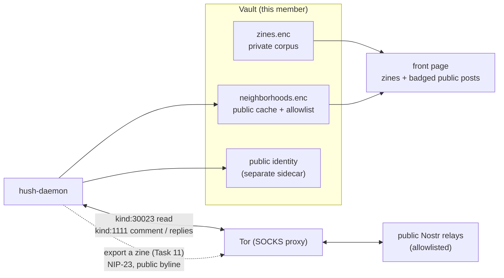

# Neighborhoods — public long-form from Nostr (planning only)

**Status:** Spec resolved 2026-10-13 by grilling; **not implemented**. No code until a phase is
explicitly approved.

**Index:** New **Task 22** in [`docs/plans/2026-10-04-v1-milestones.md`](../plans/2026-10-04-v1-milestones.md)
(Phase **P**). **Amends Task 11** ([`hush-articles.md`](hush-articles.md)): the Nostr-facing crate
gains a **read** lane beside the export bridge, and the export signs with a **separate public
identity**, not the pen-name keys. Pairs with Task **21** ([`zines.md`](zines.md)): the private corpus
is **zines**, the public corpus is **neighborhoods**, and **one front page shows both** behind a
control.

**Goal:** The front page is a newspaper with two sources. **Zines** are the members' private, E2EE
long-form. **Neighborhoods** are **public** long-form articles pulled from Nostr (NIP-23), read over
**Tor**, curated to **articles rather than notes**, cached locally, and shown on the **same page**
behind a control-pane switch. Every public post is **badged `public post`**. Publishing (export) and
commenting happen under a **public identity** deliberately separate from the private pen name.

**Name:** **neighborhoods** is the public side; **zines** is the private side. A public article is a
**post**; a private one is a **zine**.

**Non-goals (this task):** a follow-based feed or any ranking algorithm; a Hush-run Nostr relay;
short notes (`kind:1`) anywhere in the UI; remote media in v1; writing to Nostr from the private pen
name; cross-lane dedupe or auto-linking.

---

## 1. Why one page, and why the badge is load-bearing

The first shape of this was a **separate** public surface. It is now **one mixed front page** with a
control-pane switch (`Public posts`, show/remove). The change is a product call and it is fine — but
it moves the entire safety burden onto three rails, which are therefore not negotiable:

- **The badge.** Every public post carries a `public post` badge, on its card **and** on its own
  page. A reader must never have to infer which side of the wall a story is on. Public plaintext and
  members-only E2EE sharing one page is a trust-confusion bug unless the difference is *stated on
  every item*, not implied by position or styling alone.
- **Default off, with a prompt.** The switch defaults to **hiding** public posts, and the thin-corpus
  empty state offers `Show public posts from neighborhoods`. The default is off because showing
  public posts is what triggers Nostr egress; a member who has not opted in must not have the app
  reach public relays on their behalf (the distro-readiness rule: no new egress until opted in). The
  empty-state prompt is how the scarce-beginning problem is answered without silent network
  activity.
- **Lazy egress.** Nothing is pulled from Nostr until the switch is on (or a neighborhood is
  explicitly opened). Turning the switch on is the opt-in.

---

## 2. Decisions locked (2026-10-13)

| # | Decision | Choice |
|---|---|---|
| 1 | Surface | **One mixed front page**; public posts badged `public post`; a control-pane switch shows/removes them. **Default off**, with an empty-state prompt |
| 2 | Quality gate | `kind:30023` **and** a `d` tag **and** a `title`, from a **curated relay allowlist**, plus a **reading-time floor** (start ~3 min, config). **No engagement ranking** |
| 3 | Identity | A **separate public identity**, never the private pen name |
| 4 | Egress | **Tor** |
| 5 | Comments out | Allowed, signed with the **public identity** (same exposure class as export). Replies inbound are **read-only** |
| 6 | Export | **Explicit, per-post, one-way** — never automatic, never bulk |
| 7 | Inbound replies | **Read-only** on the public article's page; the private zine comment thread stays entirely separate |
| 8 | Allowlist | Shipped **default**, **user-editable**; **no Hush-run relay**; optional curator list (NIP-51) later |
| 9 | Public byline | **Separate public byline by default**; an explicit "export under my pen name" override |
| 10 | Identity count | **One public identity per vault** (storage designed for many later) |
| 11 | Identity lifecycle | A **fresh secp256k1 key** minted on an **explicit create** (never on a read), in its **own encrypted sidecar** (`public-identity.enc`), in the Task **6** backup, **never derived** from messaging or pen-name keys |
| 12 | Export transform | **Re-encode** the body; **strip** the private comment thread and revision history; sections → `t` tags; `published_at` only on first export; sign under the **public byline** |
| 13 | At rest | Pulled articles **cached encrypted** locally (offline read; the encryption is hygiene, not secrecy) |
| 14 | Media | **Drop remote images in v1** (text-only), render a placeholder; revisit with the zines media phase |
| 15 | Code | The Nostr-facing crate (`crates/hush-articles/`) serves **both** export (Task **11**) and neighborhoods (Task **22**); the product name is neighborhoods, the crate path stays to avoid churn |
| 16 | Rendering | **One** sanitizer/renderer: reuse `sanitize_rich_text` (`reads.rs`) and `sanitizeHtml` (`richText.ts`) |
| 17 | Overlap | Your exported zine, read by another member through a neighborhood, is a **separate public object** — no cross-lane linking or dedupe |

---

## 3. Architecture

- **Read lane.** The daemon polls the allowlisted relays over Tor with a `{kinds:[30023]}` filter,
  dedupes on the address `(pubkey, d)` keeping the newest `created_at` (NIP-23 is editable), applies
  the gate (Section 2, #2), and caches the survivors encrypted in `neighborhoods.enc`. The UI never
  talks to a relay.
- **Public identity.** One per vault, minted on an explicit create, stored in its own encrypted sidecar,
  carried in the backup. It signs exports and public comments. It is **not** the pen name and **not**
  the messaging identity, and nothing derives one from another.
- **Export (Task 11).** From a zine's own page, `Export to neighborhoods` re-encodes the body to
  Markdown, strips the private thread and history, and signs a NIP-23 event under the public byline.
  It is irreversible and explicitly confirmed.
- **Comments.** Outbound: a NIP-22 `kind:1111` comment signed by the public identity. Inbound: the
  daemon queries replies to your exported address and shows them read-only. The private zine thread
  (sealed-box, author-merged) is untouched and never rendered beside them.
- **The mixed page.** One corpus = private zines + (when the switch is on) public posts. The existing
  composition rules in `lib/zinesPage.ts` extend to the mixed set; the switch filters **before**
  composition, so the section strip's counts still follow what the page would actually show.

---

## 4. Wire format

**NIP-23 mapping (read and export).**

| Hush concept | NIP-23 |
|---|---|
| Article body | `.content` (Markdown) |
| Title | `title` tag (required by the gate) |
| Summary | `summary` tag |
| Banner image | `image` tag — **dropped in v1** |
| Sections | `t` tags |
| Post id | `d` tag (addressable id) |
| First publish | `published_at` (set on first export only) |
| Last edit | `.created_at` |
| Address | `naddr` (NIP-19) / `a` tag |

**Comments.** NIP-22 `kind:1111`, referencing the article's `a`/`e` and the author's `p`.

**No short notes.** `kind:1` is never fetched and never rendered. The `kinds:[30023]` filter is the
first and strongest gate: a tweet cannot arrive as a kind 30023.

---

## 5. Daemon API (proposed)

Socket-first, thin-UI, following the zines pattern (`account_worker.rs` owns the Vault; routes in
`main.rs`). All routes **401 when locked**.

| Route | Body | Returns / notes |
|---|---|---|
| `GET /api/neighborhoods` | — | The cached public index; filters `?section=` / `?pub=` |
| `GET /api/neighborhoods/{addr}` | — | One article + its read-only replies (404 before it is held) |
| `POST /api/neighborhoods/refresh` | — | Force a pull from the allowlisted relays (the switch-on path). `503` when Tor is not running; `502` when every relay fails |
| `POST /api/neighborhoods/{addr}/comment` | `{body}` | Sign and post a NIP-22 comment with the public identity |
| `GET /api/neighborhoods/identity` | — | The public identity (pubkey + `npub`), or `null` before one exists. A read never mints |
| `POST /api/neighborhoods/identity` | — | Mint the public identity. Idempotent: a create when one exists returns it |
| `GET /api/neighborhoods/settings` | — | Allowlist, reading-time floor, the `Public posts` default |
| `POST /api/neighborhoods/settings` | `{allowlist?, min_minutes?, default_show?}` | Persist settings |
| `POST /api/zines/{zine_id}/export` | `{byline?}` | Export a zine (Task **11**); returns the `naddr`. Refused for a zine this vault does not hold |

---

## 6. UI — the mixed front page

- **The page** is one newspaper: masthead, the section strip, a lead, then the runs — now over a
  mixed corpus when `Public posts` is on.
- **The switch** lives in the control pane (`Public posts`, show/remove). **Default off**; the
  thin-corpus empty state offers it.
- **The badge.** Every public card and public story page carries a `public post` badge. A public
  story page also carries honest copy: public, permanent, and **not removable** (NIP-09 is a
  request).
- **The lead** prefers a private zine when any private story is visible; a public post leads only
  when the visible set has none. The front page is the members' paper first.
- **Mute** works across both (per private byline; per public `pub`/byline).
- **A public story page** shows read-only replies and a `Comment publicly` affordance (public
  identity). **A private zine page** keeps its sealed-box comment thread and adds
  `Export to neighborhoods`. The two comment surfaces are visually distinct and never merged.

---

## 7. Threat model delta

Add to [`THREAT_MODEL.md`](../THREAT_MODEL.md) when implementing.

| New surface | What it may see | Rule |
|---|---|---|
| Read egress | The allowlisted relays learn **which relays and npubs you query** (read interest); **Tor** hides the IP | Accepted with Tor. Reading is the same "announce your interest" class zines §1 rejected on a public DHT, now mitigated by Tor and a curated set |
| Public identity | A key separate from messaging and pen name, one per vault | Never derived, never co-located with the pen name; in the Task **6** backup; loss = public-identity loss |
| Export | Plaintext, permanent, public; **not removable** (NIP-09 is a request) | Explicit per-post consent with plain copy; the export transform (Section 2, #12) breaks hash correlation with the private blob |
| Public commenting | Accumulates a **public interaction graph** (`p`/`a`/`e` tags): who you reply to, about what, when | Accepted as the cost of a public lane; signed only by the public identity |
| Public→private linkage | The residual risk is **stylometry / co-occurrence**, not the event itself | Controls: separate keys, no shared metadata, per-identity Tor circuit, no auto-cross-posting |
| Inbound replies | Public and **unmoderatable**; only a **local hide** exists | Honest copy; never merge with the private thread |
| At rest | `neighborhoods.enc` sealed under the vault master key | Cached public content is encrypted for hygiene, not secrecy |

**Honest limits for user-facing copy:** a neighborhood post is public, permanent, and cannot be
un-published; commenting publicly is permanent and linkable to your public identity; the app reaches
public relays only when you turn the switch on.

---

## 8. Phases and acceptance criteria

### Phase 0 — Spec (this document)
- [x] Decisions in Section 2 resolved (2026-10-13).
- [ ] `THREAT_MODEL.md` addendum (Section 7), `PROTOCOL.md` note, and `DISTRO_READINESS.md` egress entry when implementation starts.

### Phase 1 — Public identity (offline, no network) — **landed 2026-10-13**
- [x] Mint one secp256k1 public identity on an **explicit create**, not on a read, so a stray GET cannot publish under a key nobody chose. It gets its own encrypted sidecar (`public-identity.enc`, sealed under the vault master key) and is in the Task **6** backup by construction, because the backup walks the vault directory.
- [x] Isolation is tested against the account identity, the drop key, and the pen name; two vaults with the same identity material mint unrelated keys; and the pubkey is checked against the canonical secp256k1 generator vector with the `npub` decoded back to it.
- [x] It lives in the vault (`crates/hush-core/src/vault.rs`) beside the pen name, because it is key material; the daemon exposes it at `GET`/`POST /api/neighborhoods/identity`. The Nostr-facing crate (`crates/hush-articles/`) is **Phase 2**, with the network.

### Phase 2 — Read lane — **landed 2026-10-13**
- [x] Dedupe on `(pubkey, d)` keeping the newest `created_at` (NIP-23 is editable); apply the gate; cache encrypted in `neighborhoods.enc`; local index with `?section=` / `?pub=`. Built in `crates/hush-articles/` as the lane's logic, with the daemon owning the sidecar and the routes.
- [x] `kind:1` is never fetched and never mapped: the filter can only express `kind:30023`, and the mapping refuses any other kind, so a relay returning one is ignored. Tested on both sides.
- [x] Poll the allowlisted relays **over Tor**. The transport is a hand-rolled minimal NIP-01 client (`hush_articles::RelayClient`): a WebSocket dialled through the SOCKS proxy the shell reports for Tor, `REQ` → `EVENT` until `EOSE` → `CLOSE`. `POST /api/neighborhoods/refresh` reads that SOCKS port and refuses (`503`) when Tor is not running; there is no clearnet path by construction, because `RelayClient::via_tor` is the only constructor the daemon builds. Verified against a local relay and a stand-in SOCKS proxy, and since against **Tor and live public relays**: a refresh through the bundled Tor's SOCKS port returned `200` in 20.0s and cached 91 articles from the allowlist. That run also required a fix unrelated to this lane — the daemon panicked on its first TLS handshake because two rustls providers are enabled — see [`DEEPSEEKPROBLEMS.MD`](../../DEEPSEEKPROBLEMS.MD).

### Phase 3 — The mixed page — **landed 2026-10-13**
- [x] The `Public posts` switch lives in the control pane, defaults **off** (read from `/api/neighborhoods/settings` once per session, so a saved `true` survives a reload but a choice made this session is never clobbered), and filters the corpus **before** composition: `zinesHeld()` concatenates the lanes and the section strip, the lead and the runs all read from it, so a control that hides stories cannot leave a strip entry promising stories that are not there. Turning it on is the opt-in: it saves the default and pulls once; turning it off only hides — the cache stays.
- [x] The `public post` badge renders on cards (kicker) and on the story page, which also carries honest copy: public, permanent, **not removable**, and opening it makes no request. The article body is a stranger's Markdown through `markdownToHtml` → `sanitizeHtml` → `guardLinks` (Section 2, #16), so no remote image or navigable link arrives from a relay.
- [x] The lead prefers a private zine whenever one is visible; a public post leads only when the visible set holds none. A public post is not "mine" under `Mine only` — the lane is left out rather than printed under a byline that did not write it.
- [x] `lib/zinesPage.ts` composes over a normalized `FrontPageStory` (`zineStory` / `postStory`), so the layout rules are answered once for both lanes: `newestFirst` (ties break on id), `leadOf`, `badgeOf`, `sectionCounts`, `groupBySection`, `bylineOf`, `byByline`, and `publicByline` (names the key the vault actually holds — `kind:0` metadata is never fetched). Covered by `zinesPage.test.ts` (22 tests) and the renderer by `markdown.test.ts` (13).

### Phase 4 — Export and commenting — **landed 2026-10-13**
- [x] `Export to neighborhoods` (Task **11**): re-encode, strip the private thread and history, sign under the public byline, return the `naddr`. The body is re-encoded from HTML back to Markdown (`reads::rich_text_to_markdown`) over the sanitizer's own allow-list, so an export cannot smuggle markup the reader never had; the thread and the history are dropped by construction rather than by a filter — `ExportPlan` has no field to carry them. The publish is a NIP-01 `EVENT` sent through the same Tor-only `RelayClient` and waits on each relay's `OK`; a relay that is down or silent is a refusal like any other, and `published` is `false` only when no relay took it. The address is minted and recorded **before** the send, so a failed export retries at the same address instead of publishing a second article beside the first, and the response says which happened. The signed event is verified BIP340 in the daemon's tests, not trusted from the builder.
- [x] `Comment publicly` (NIP-22, `kind:1111`) and read-only inbound replies on the public article's page; the private thread is untouched. Root scoping rides the uppercase tags (`A`/`K`/`P`) and parent scoping the lowercase ones (`a`/`e`/`k`/`p`), with at most one allowlisted relay hint per tag so the positional `pubkey` on an `e` tag cannot be displaced. `POST /api/neighborhoods/{addr}/comment` refuses an article this vault does not hold (`404`), an empty or over-long body (2000 chars) and a `parent_id` that is not in this thread (`400`), a comment before a public identity exists or with no relays configured (`409` — it does not mint the key it would speak under), and any comment at all while Tor is down (`503`). The comment is cached locally **only after** a relay returns `OK`: a refused publish leaves the cache untouched, and the reply list in the response is the one actually held, tested as such.
- [x] Refresh is two passes over one Tor client: pass 1 pulls `kind:30023` articles, pass 2 pulls `kind:1111` comments scoped by `#A` to the addresses this vault has exported (`ZinesState::export_scopes`), so a vault reads the replies to what it published and nothing else. Replies are capped (`REPLIES_CAP = 2000`) and evicted oldest-first, and a relay answering about a thread this vault did not ask for has its comment dropped at the door rather than cached: the scope list is what the vault exported, so it cannot accumulate replies to articles it does not hold.
- [x] The article page draws the thread from the flat cache: `publicThread` builds the tree (oldest first at every level, a reply whose parent is not held shown rather than lost, a cycle broken to a top-level row instead of a hang) and `flattenThread` flattens it back with the depth it was drawn at, capped at `THREAD_MAX_DEPTH = 2`. The composer is gated on the public identity and answers the state honestly — checking, none with an explicit "Create a public identity", or the box — because a comment cannot leave without a key and a page that let the reader write first would fail them at the send. Both functions and the composer's decisions are covered in `zinesPage.test.ts`.
- [x] The private thread and the public thread are never merged: different store, different key, different readers. The public one is drawn as read-only and says so in copy, since the only thing this page can do about a comment on a public network is stop showing it locally.

### Phase 5 — Hardening and docs
- [ ] Allowlist UX (edit, health); per-identity Tor circuit; `DISTRO_READINESS.md` records the Tor egress beside the messaging relay client.

---

## 9. What not to build

- A follow-based feed, a global firehose, or any engagement ranking — the newspaper model is pull-only.
- A Hush-operated Nostr relay.
- Short notes (`kind:1`) anywhere in the UI.
- Remote media in v1.
- Writing to Nostr from the private pen name.
- Cross-lane dedupe, auto-linking, or merging the private and public comment threads.
- A second sanitizer/renderer.

---

## 10. Open questions (not blocking Phase 1)

| # | Topic |
|---|---|
| 1 | **Reading-time floor** — start ~3 min; settle the number against a real corpus |
| 2 | **Allowlist maintenance** — who curates the default set, and how it is updated in a release |
| 3 | **Curator lists** — subscribe to a third party's NIP-51 list as a portable editorial board |
| 4 | **Discovery** — NIP-50 relay search within the gated set, or local FTS only |
| 5 | **Per-neighborhood identities** — multiple public identities later, matching the pen-name model |
| 6 | **Stylometry** — any countermeasure beyond separate keys, if it proves needed |
