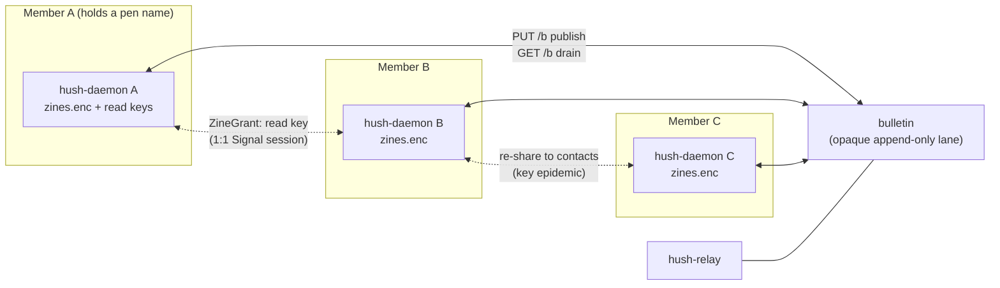

# Zines — members-only long-form publishing (planning only)

**Status:** Spec resolved 2026-10-12 by grilling; **not implemented**. No code until a phase is
explicitly approved.

**Index:** New **Task 21** in [`docs/plans/2026-10-04-v1-milestones.md`](../plans/2026-10-04-v1-milestones.md)
(Phase **O**). **Reshapes Task 11** ([`hush-articles.md`](hush-articles.md)) — Nostr stops being the
native shape and becomes an optional **export bridge**. Builds on Task **19**'s sidecar-store +
fan-out spine ([`conclave-paper.md`](conclave-paper.md)); adds one relay ability.

**Neighborhoods (Task 22, 2026-10-13):** the front page can also carry **public** long-form pulled
from Nostr, on the **same page** behind a control-pane switch and always badged `public post`. Public
posts use a **separate public identity** (never the pen name) and egress over **Tor**. See
[`neighborhoods.md`](neighborhoods.md). The earlier "a separate public surface" idea is superseded by
the mixed page; the badge and the default-off switch are what keep the two sides distinguishable.

    10|**Goal:** Every member has a **zine** — a long-form post with a comments section, published under
their **pen name**, readable by **all members** (not just contacts), end-to-end encrypted, with no
server holding plaintext. A pen name holds **many** zines: each post is its own zine, with its own
read key and its own revision chain. Posts and comments are **broadcast** to a relay **bulletin**
and held in every member's vault; readability propagates **holder-to-holder** over existing 1:1
sessions. Sections (tags) ride inside the encrypted post. Browsing is local and pull-only — a
newspaper you read what you want from, with no follows and no algorithm.

**Name:** **zines** (product name, lowercase in prose). An article is a zine; a tag is a **section**.
    20|
**Amended 2026-10-13 (before Phase 2):** Phase 1 shipped a zine as one post with a revision chain and
made the pen name's seal key the post id, which limited a pen name to a single post — the id could
not address two things. The model below is the corrected one: the pen name's seal key is
`pen_id`, a post's id is minted per post, and each post carries its own read key. The cost is stated
where it belongs, in the read-key row of Section 2.

**Non-goals (this task):** images/media (a later phase); public plaintext or the public IPFS DHT
    20|(Section 1); a relay-side category registry (Section 1); follows/subscriptions (newspaper model);
cross-relay federation (Section 4); Nostr as the native transport (now an export bridge); a
Hush-operated Nostr relay.

---

## 1. Why not IPFS / a public DHT, and why not a relay category registry

Two parts of the original idea were corrected before the design locked. Recording both, because
they are the reason the architecture is shaped the way it is.

**"Articles live on IPFS and vanish when nobody logs in" is not how IPFS GC works, and the public
DHT is a metadata leak.**
    30|
- Blocks vanish when **no node anywhere pins or seeds them**. An author's login only re-provides
  their *own* content; what keeps a zine alive is **readers pinning it**. Availability is a function
  of the readers, not the author's uptime — so "people who do not log in lose their blog" is not a
  mechanism IPFS gives you. Neglected zines die while popular ones outlive their authors.
- Providing or fetching a CID announces your IP **and your interest in that exact content** to the
  swarm. Every document in this repo treats "the relay cannot learn who reads what" as a v1
  constraint ([`DESIGN.md`](../DESIGN.md), [`THREAT_MODEL.md`](../THREAT_MODEL.md)); a public DHT
  breaks it on day one. A private swarm avoids the leak but is a second network stack (libp2p
  bootstrap, a new egress surface in [`DISTRO_READINESS.md`](../DISTRO_READINESS.md)) that text-only
  v1 does not need.

    40|**"The relay holds the names of categories" is a relay directory, which the founding constraint
forbids.** [`PROTOCOL.md`](../PROTOCOL.md): the relay sees ciphertext, size, time, slot ID, IP —
never names, never a directory, never a social graph. A plaintext category registry makes the relay
a public interest graph and is a typosquat magnet (free-form tags, first-writer-wins). Categories
therefore live **inside the encrypted descriptor** with the article; a section exists wherever
members hold posts carrying that tag, and browsing is a local facet. No registry, no cardinality
cap, no relay knowledge.

**What replaces both:** the relay's one new ability is a **generic broadcast lane** (the bulletin)
carrying **opaque blobs** — no names, no tags, no pen names. Content addressing and "hold what you
hold" live in the members' vaults, which is where the availability story actually is.

    50|---

## 2. Decisions locked (2026-10-12)

| Decision | Choice |
|---|---|
| Audience | **Members-only**, end-to-end encrypted. Not public, not contacts-only |
| Author identity | **Pen name** — a vault keypair isolated from messaging keys (the Task 11 doctrine); one pen name per vault, **many zines (posts) per pen name**; multiple pen names later |
| Delivery | **Relay bulletin** — one new, generic, opaque, append-only **broadcast lane**. Any member may publish; any member drains. Content-blind, name-blind |
| Readability | **Key epidemic** — the bulletin carries ciphertext encrypted to the zine's read key; read keys propagate holder-to-holder over existing 1:1 Signal sessions |
| Read key | **One per zine, and a zine is one post.** One grant reads that post forever after. The honest cost: a reader needs a **grant per post**, so a prolific author's readers collect grants rather than one. Accepted 2026-10-13 over a per-pen-name key, which would have needed a post registry inside one blob and made "which posts exist" a rewrite of the whole zine. No revocation; rotation is later |
| Sections (tags) | **Inside the encrypted descriptor**; a local facet index. No relay registry |
| Comments | Blobs encrypted to the pen name's **public** key, published to the same lane; the author pulls, merges accepted ones, republishes |
| Edits | New blobs; a revision pointer in the descriptor, **per post**; old revisions age out with the window and are pruned locally |
| Browsing | **Newspaper model** — no follows, no subscriptions; the full local index (all / by section / by pen name), local mute per pen name |
| Beyond Hush | Optional later **export** (Nostr NIP-23) signed under a **separate public identity**, never the pen-name keys — a button, not a second product. The paired **read** lane is **neighborhoods** (Task 22): badged public posts on the same front page behind a control |
| Scope | **Text-only rich text** (Paper's toolbar: bold/italic/underline, lists, headings) |
| Milestone | Task **21** / Phase **O** |

**One correction to the "blog = single-author Paper" framing:** zines reuse Paper's **spine** — the
sidecar-store pattern, the per-trustee fan-out, the payload codec, the tolerant decode — but **not
its CRDT**. A zine article has exactly one writer (its pen name) and each comment is a separate
signed blob merged by the author, so there is nothing to merge concurrently. The editor reuses
Paper's **ProseMirror rendering** and toolbar but **not** `y-prosemirror`/`yrs`. That makes zines
lighter than Paper, not heavier.

---

## 3. Architecture



- **Bulletin (broadcast lane).** One new relay ability: an append-only log of **opaque blobs**,
  addressed to nobody. A member publishes with their existing member credential; any member drains
  it. The relay stores `(seq, body, inserted_at)` and **does not record which member published which
  blob**. It is the first route not keyed to a specific queue or account, and it is the deliberate
  exception to "the relay gains no new abilities" — Section 7 states exactly what it costs.
- **Key epidemic (readability).** There is no "all members" key and no member list to encrypt to, so
  the bulletin cannot carry readable articles to a stranger. Instead: **delivery is broadcast,
  readability is epidemic.** A post is sealed under its own symmetric **read key**; the author
  hands that key to a contact as a `ZineGrant` over their existing 1:1 session; **any holder** may
  re-share the same key to *their* contacts. A member may therefore hold an unreadable blob until a
  key reaches them, then a local "retry unreadable blobs against the new key" sweep classifies it.
  One grant covers one post, so a reader of a prolific author collects a grant per post — the
  consequence of a key per post rather than per pen name (Section 2, read key). This is the price of
  members-only E2EE on a broadcast lane; the alternative is public plaintext, which is rejected.
- **Comments.** A comment is sealed to the pen name's **public** key (no session to the author is
  required to write one) and published to the same lane. The author drains, tries to open each
  unclassified blob with the pen-name private key, keeps the ones that open, merges the accepted
  ones into the article's comment thread, and republishes. **Moderation is entirely author-side**:
  an unmerged comment is simply never republished and ages out with the window. The honest limit is
  that a commenter cannot force publication — the same power a blog host always had.
- **Vault.** `zines.enc` encrypted sidecar (the `notes_store`/`papers.enc` pattern): my own zines
  (drafts, published revisions, the merged comment thread), **held** zines from others, the **read
  keys I hold**, and the local section index. Read keys are secrets, so they are only ever at rest
  encrypted here. Caps refuse with a reason (the house pattern).
- **Editor.** ProseMirror in the webview with Paper's toolbar, rendered from local assets; a zine
  body is text + marks. No CRDT, no `yrs`. The daemon owns state and wire (thin-UI doctrine).
- **Browsing.** The daemon keeps a local index over everything held: filter by section, by pen name,
  newest-first with author-declared `created_ms` **clamped** (a future timestamp is forgeable — the
  old articles feed rule). No follows; local mute per pen name is the only feed control.

---

## 4. Wire format

**Relay lane (new).** The bulletin carries opaque blobs. It is **not** a `MessagePayload` — it never
touches a Signal session. Its shape is in Section 5.

**Session payload (new).** One new `MessagePayload` variant carries read keys; it is the only zine
thing that rides the 1:1 sessions.

```rust
pub enum MessagePayload {
    // ... existing ...
    // Task 21 — Zines:
    /// A zine's read key, wrapped for one recipient over their existing session.
    /// Doubles as the announcement: the recipient learns a zine exists and can
    /// then find its blobs on the bulletin by trying the key.
    ZineGrant { zine_id: String, key: Vec<u8>, latest_hash: String },
    /// A tag this build does not know. Decoded, never sent. (Shared with Paper.)
    Unknown,
}
```

- **`ZineGrant`** is the key epidemic in one payload: `zine_id` is the **post's** id (hex),
  `key` is the symmetric read key (house `b64_bytes` codec), and `latest_hash` lets the recipient
  identify the newest blob without trial decryption. Authority-free to *receive* (any holder may
  re-share a key they hold); it grants read, never write. One grant, one post: the author's identity
  is not in the payload, so a grant leaks nothing about what else that pen name has published.
- **No article payload.** Articles and comments ride the bulletin, not the fan-out. This keeps the
  Signal fan-out cost at zero for a zine that has many readers.
- **`Unknown`** reuses the tolerant decode Paper landed 2026-10-12; a zine-aware build and a
  Paper-only build interoperate.

**Article blob (opaque to the relay).** Sealed under the read key; the plaintext descriptor is:

```rust
pub struct ZineDescriptor {
    pub zine_id: String,      // this post's id, minted at create
    pub pen_id: String,       // the author's seal public key, hex (the identity)
    pub pen_name: String,     // display name chosen by the author
    pub title: String,
    pub sections: Vec<String>,// tags; exist only where members hold them
    pub created_ms: u64,      // author-declared; clamped on ingest
    pub revision: u64,        // monotonic per post
    pub prev_hash: String,    // previous revision's content hash (chain)
    pub body: String,         // rich text (ProseMirror JSON or sanitized HTML)
    pub comments: Vec<ZineComment>, // merged thread, author-curated
}
```

- `zine_id` and `pen_id` are deliberately separate fields: the id is an **address** (what a grant
  and a blob reference) and the pen name is an **identity** (what a comment is sealed to, what a
  byline rename follows, what a reader groups by). Phase 1's first shape made the seal key the id,
  which is what limited a pen name to one post.
- The blob is **content-addressed** by `hash(bytes)`; the hash is what `ZineGrant.latest_hash` and
  `prev_hash` reference. Authorship is proven by the **pen name's signature** over the canonical
  plaintext (a holder can verify provenance without holding the read key); integrity is **AEAD**, so
  the relay cannot tamper undetected.
- **Sections are inside the descriptor**, so the relay never sees a tag and the pen name never
  appears on the wire. A section "exists" for a member once they hold a post carrying it.
- **Edits** are a new blob with `revision + 1` and `prev_hash` pointing at the last; the newest
  revision a member holds wins. A chain belongs to one post, so publishing a second post starts at
  revision 1 rather than extending the first. Old revisions age out with the window and are pruned
  locally.

**Comment blob (opaque to the relay).** Sealed to the pen name's **public** key (ECIES sealed box,
the `hush-drop-v2` construction already in the tree). The author tries to open each unclassified
blob; a failure is not an error, it is simply not theirs. A recipient tag (a truncated
`H(ephemeral_pubkey ‖ pen_name_pubkey)`) is an **optimization** for a large corpus, not required in
v1 — trial decryption is cheap at text scale.

---

## 5. Relay bulletin API (new)

Reuses the existing queue authz primitives ([`crates/hush-relay/src/store.rs`](../../crates/hush-relay/src/store.rs)):
a member proves membership with the credential for a queue they own.

| Route | Auth | Behavior |
|---|---|---|
| `PUT /b` | member **delivery** credential (`{queue_id, delivery_token}` for a queue they own) | Append the opaque body to the bulletin log. Rate-limited per `queue_id`. **The stored row carries no queue id** |
| `GET /b?since={seq}` | member **read** credential (`{queue_id, read_token}`) | Return blobs with `seq > since`, in order. Everyone drains the same lane, so a drain reveals no readership |

- **Storage:** `bulletin(seq INTEGER PRIMARY KEY, body BLOB, inserted_at INTEGER)`. The relay's
  transient knowledge of the publisher (it must authorize) is **not persisted** alongside the blob.
- **Cap:** `bulletin_max_blob_bytes` = **256 KiB** (the text-only article cap; well under the
  existing `max_blob_bytes` = 1 MiB).
- **TTL:** its own `bulletin_ttl`, proposed **30 days** — longer than the chat `blob_ttl` (7 days)
  because the bulletin is the corpus store, not a drained inbox. Survival past the window is the
  holders' vaults plus the re-post sweep (Section 8, Phase 5).
- **Rate limit:** per member credential, on top of the existing per-queue limits.
- **Dedup (optional):** the relay may dedup by content hash and refresh the row's TTL on re-post —
  it can hash the bytes anyway, so this adds no leak and saves storage.
- **No new directory, no names, no tags, no pen names.** The bulletin is one flat opaque log.

**Per-relay, not global.** Relays never talk to each other
([`PROTOCOL.md`](../PROTOCOL.md#many-relays-clients-route-relays-never-talk-2026-10-09-design-not-built)),
and a member holds slots on their **home** relay, so the bulletin is **per-relay**. "Eventually
everybody has the same zines" across relays is the **holder re-post sweep** re-publishing to *their*
relay's bulletin. No federation, no relay-to-relay path — the epidemic does the routing.

---

## 6. Daemon API (proposed)

Socket-first, thin-UI, following the paper/notes pattern (`account_worker.rs` owns the Vault; routes
in `main.rs`). All routes **401 when locked**.

| Route | Body | Returns / notes |
|---|---|---|
| `GET /api/zines` | — | Local index: my posts + held posts; filters by `?section=` / `?pen=` (the byline, or a `pen_id` prefix) |
| `POST /api/zines` | `{zine_id?, title, sections[], body}` | Absent `zine_id` publishes a new post and mints its id; a present one revises that post. Answers with the index **and** the id written, because a create's id is the daemon's to choose. A `zine_id` this vault does not hold is refused, never treated as a create |
| `GET /api/zines/{zine_id}` | — | The post + merged comment thread (404 before it is held) |
| `POST /api/zines/{zine_id}/comment` | `{body}` | Seal to the pen-name public key and publish to the bulletin |
| `POST /api/zines/{zine_id}/accept-comment` | `{comment_hash}` | Merge one pulled comment into the thread; republish |
| `POST /api/zines/{zine_id}/grant` | `{contact}` | Send `ZineGrant` over the 1:1 session (the key epidemic, author side) |
| `POST /api/zines/{zine_id}/mute` | `{muted}` | Local mute; no wire effect |

Bulletin drain, trial decryption, key re-sharing, and the re-post sweep are daemon-internal. The UI
sees a local corpus and a **sync status** (drained up to seq N; N unreadable blobs pending a key).

---

## 7. Threat model delta

Add to [`THREAT_MODEL.md`](../THREAT_MODEL.md) when implementing. This is the **first new relay
ability since the founding constraint**, so it is stated in full.

| New surface | What it may see | Rule |
|---|---|---|
| Bulletin lane | Opaque blob sizes, count, times; **not** which member published which blob in storage | Accepted. The relay stores a flat log with no author column |
| Publish linkability | At publish time the relay **must** authorize, so it transiently learns **which member published a zine blob** (the Q3 cost) | **Accepted and documented** — narrower than what the operator already knows (payment identity). Drains reveal no readership (everyone drains everything). Optional Tor-path publish is the later fix |
| Re-post linkability | A re-post tells the relay a member **holds** that zine | **Accepted** — in a converging commons (everyone holds everything) this is near-zero signal; it matters only for a zine you would rather not be seen holding. It is the price of author-independent availability |
| Read keys | Held in `zines.enc`, encrypted at rest; a holder's grant grants **permanent** read of that zine | **No revocation**, like a kicked trustee keeping conclave messages. Rotation is a later concern |
| Comments | The relay sees an opaque blob; only the pen name can open it | Accepted. A commenter's slot is linkable to the publish, same as an article |
| Corpus size | Every member downloads every blob | Bandwidth, not privacy. Text-only keeps totals in low MBs; the per-member rate limit is the throttle |
| At rest | Nothing in plaintext | `zines.enc` sealed under the vault master key; locked vault = unreadable; editor runs from local assets only |

**Honest limits for user-facing copy:** publishing reveals your member slot to the relay operator
(not to other members); a zine you hold can be seen to be held if someone re-posts it; read access,
once granted, is not revocable; and every member holds a copy of what they have received — zines are
not "leaves nothing behind."

---

## 8. Phases and acceptance criteria

### Phase 0 — Spec and threat model (this document)
- [x] Decisions in Section 2 resolved and recorded (2026-10-12).
- [ ] `THREAT_MODEL.md` addendum (Section 7) and `PROTOCOL.md` bulletin subsection when implementation starts.

### Phase 1 — Pen names, store, editor (offline, no network) — landed 2026-10-12
- [x] Pen-name keypair in the vault (isolated from messaging keys); backup manifest carries it.
      `crates/hush-core/src/vault.rs` (`PEN_NAMES_FILE`, `create_pen_name`, `rename_pen_name`),
      `crates/hush-core/src/account.rs`, `crates/hush-daemon/src/account_worker.rs`. The isolation
      test asserts the pen-name id differs from both the identity key and the drop key, and that two
      vaults with the same identity material mint unrelated pen names.
- [x] `zines.enc` sidecar: descriptor + revision chain + merged comments + held zines + read keys;
      caps with reasons; round-trip and corruption tests. `crates/hush-daemon/src/zine_store.rs`.
- [x] **Many posts per pen name** (amended 2026-10-13, before Phase 2 landed). A post's `zine_id` is
      minted at create and the author's seal key lives in `pen_id`, so one pen name holds many posts
      with independent chains and independent read keys; `ZinesState::migrate` re-addresses records
      written by the first shape on the first read. A revision naming a post this vault does not hold
      is refused rather than treated as a create. `zine_store.rs`, the Zines pane in `app.ts`.
- [x] `/api/zines/*` local routes; lock = 401 everywhere. `crates/hush-daemon/src/main.rs`
      (`/api/zines`, `/api/zines/pen-name`, `/api/zines/sections`, `/api/zines/{zine_id}`,
      `/api/zines/{zine_id}/mute`), tested by `zines_api_tests`. `POST /api/zines` answers with the
      index plus the id it wrote, because a create's id is the daemon's to choose.
- [x] ProseMirror editor + toolbar (no CRDT), rendered from local assets.
      `apps/hush-tauri/src/lib/proseSchema.ts` (shared with Paper), `apps/hush-tauri/src/lib/zineStore.ts`,
      the Zines pane in `apps/hush-tauri/src/app.ts` (Rail button, the front page and its
      controls pane, pen-name modal, forget confirmation), `apps/hush-tauri/src/styles/app.css`,
      `apps/hush-tauri/src/lib/zinesPage.ts`.

**Verify:** author a zine with sections, restart — it survives; lock — every route 401s and `zines.enc`
on disk is ciphertext; `cargo test -p hush-daemon`.

**Verified 2026-10-12** in the real UI (Vite on 5173 against the daemon on 9876): a pen name was
minted, an article was authored with sections `rust, notes` and a bold run, published, and reopened
from the list — title, byline, tags, body, and facet counts all rendered, and the body carried its
`<strong>` mark through sanitizing. `zines.enc` is ciphertext at rest (`zines_sidecar_is_ciphertext_at_rest`),
a restart survives (`a_zine_survives_a_restart`), and every route is 401 while locked
(`every_zine_route_is_401_while_locked`). `cargo test -p hush-daemon`: 157 passed.

**Verified 2026-10-13** for the many-posts reshape, on `peer-a` (a vault holding a real record from
the first shape: revision 3, two superseded revisions, a read key). `cargo test -p hush-daemon`: 163
passed; `cargo test --workspace`: green; `npx tsc --noEmit` and `npm run build`: clean; UI suite: 16
passed. The migration ran once on first read and persisted: the record's id moved from the pen name's
seal key to a minted uuid, `pen_id` recovered the identity, and revision, history, `prev_hash`, body
and read key were all intact — and the id was unchanged after a restart, which a second migration
could not have produced. In the live pane: "Write a post" published a second post under the same pen
name (two rows, both marked "Yours", the first untouched at rev 3), "Write a new revision" seeded
itself with that post's own title and body, and publishing it took the first post to rev 4 with three
history entries while the second stayed at rev 1. The scratch posts were forgotten afterwards, leaving
the vault with the migrated original only. Problems hit are logged in
[`DEEPSEEKPROBLEMS.MD`](../../DEEPSEEKPROBLEMS.MD) (2026-10-13 section).

**Verified 2026-10-13** for the front page, in the real UI (Vite on 5173 against the daemon on 9876,
vault `peer-a`, driven over CDP): 33 assertions, all passing. The masthead and its dateline render,
the strip reads `All 2 / politics 1`, the lead is set at 40px in the serif face while the body stays
in the interface font, the remaining story is filed under `politics`, and the pane's text contains no
headline at all — the pane is controls. Clicking a headline opens the story with `← Front page` and
the body; coming back restores the front page's scroll position (149px out, 149px back, at a 420px
viewport so the page really scrolled). Picking a section drops the group headings and leaves only
that section's stories; `Mine only` narrows the page *and* the strip counts together. Muting the lead
from its own page hands the lead to the next unmuted story, prints the muted one as a muted card
under `Unsorted`, and the pane's `Muted posts` switch hides and restores it; unmuting gives the lead
back. Edge checks: the draft editor keeps a real height in the new container, `Discard` returns to
the front page, and at the app's 760px minimum width the page does not overflow and the card grid
collapses to one column. `npm test`: 26 passed (10 new, for `lib/zinesPage.ts`); `npx tsc --noEmit`
and `npm run build`: clean.

### Phase 2 — Bulletin lane (broadcast delivery)
- [x] Relay: `PUT /b` / `GET /b`, storage without an author column, cap, TTL, per-member rate limit; relay tests (unauthorized publish fails; TTL drops; a drain is not attributable).
- [x] Daemon: publish a signed sealed blob; drain the lane; content-addressed dedup; signature + AEAD verification.
- [x] Unreadable blobs are held, not discarded.

**Verify:** two daemons and a real relay: A publishes; B drains the blob (still unreadable); `relay.db` holds no pen name, title, tag, or body plaintext.

**Verified 2026-10-13** by `zines_bulletin_tests::a_published_zine_reaches_a_reader_unreadable_and_the_relay_holds_no_plaintext`
(`cargo test -p hush-daemon`), which runs a real relay on a port with two daemons and two vaults. A
publishes `TITLE-MARKER` / `SECTION-MARKER` / `BODY-MARKER` under `BYLINE-MARKER`; B polls and the
index holds **no post** but `held_blobs: 1`, `unreadable_blobs: 1` — an unopenable blob is not
rendered as an empty article. The relay's own database file is then read bytewise and none of the four
markers appears anywhere in it. A second poll does not duplicate the blob, and the cursor did not
rewind. The relay's own suite (`crates/hush-relay/tests/bulletin.rs`) covers the lane directly:
publish and drain authorize on the read token, an unauthorized publish is refused, the blob cap and
the TTL drop, the stored row carries no author, and a re-post keeps its `seq`.

### Phase 3 — Key epidemic + comments
- [x] `ZineGrant` send/receive; a holder re-shares to their contacts; the retry-unreadable sweep classifies newly readable blobs.
- [x] Comments: seal to the pen-name public key, publish, pull, trial-decrypt, merge, republish.

**Verify:** A publishes; grants B; B reads; B re-shares to C who has no session with A; C reads; C comments; A merges it and B/C see the merged thread.

**Verified 2026-10-13** by `a_grant_makes_a_held_blob_readable_and_a_comment_comes_back_merged` and
`a_holder_re_shares_a_key_it_was_given`. The first: A publishes; B drains and holds it unreadable; A
grants over the session; B's *next poll* re-tries the blob it already holds and the post opens
(readable, titled, sectioned) with `unreadable_blobs` back to 0. B comments; the comment is sealed to
A's pen name, published, and `published: true` is reported. A polls and the comment waits in
`pending_comments` — pulled but **not** merged. Accepting it opens revision 2 and republishes; B
drains and sees the merged thread at revision 2 with the commenter's byline. A second comment is then
refused and drops out of the pile. The second test walks the re-share: A publishes, grants B, B
**re-shares to C** (a member C has no session with A for), and C reads the post — which is the
epidemic proper, and the only path by which readability reaches beyond the author's own contacts.

### Phase 4 — Browsing
- [x] Local index: all / by section / by pen name; newest-first with clamped timestamps; local mute.
- [x] Unreadable-blob indicator and empty states; honest copy from Section 7.

**Verify:** a corpus of several zines browses by section and pen name; a muted pen name disappears locally with no wire effect.

**Note (2026-10-12):** the index, the section facet, newest-first ordering with clamped timestamps,
the local mute, and the unreadable/empty states all landed with Phase 1 — `ZinesState::index` takes
both filters and the pane renders the facets. What Phase 4 still owes is the pen-name filter in the
UI and a corpus to browse, so the boxes stay unticked.

**Landed (2026-10-13) — the pen-name filter, the corpus note, and the honest copy.** The byline is a
control on both a card and a story: clicking it narrows the front page to everything signed by that
byline, and the page carries the active filter as a chip with its own way out (`renderZinesPenFilter`).
The rule lives in `lib/zinesPage.ts` (`byByline`) with unit tests, and it is deliberately **whole-name
and case-insensitive** rather than the daemon's substring `pen` query — a reader clicking "ada" is
asking for ada, not for everyone whose name contains it. The filter is applied to the corpus this vault
already holds, so the strip's counts and the page's stories still come from one payload. The corpus note
(`renderZinesCorpusNote`) prints the held/unopened blob counts only when there is something unopened to
report, and says why those bytes are kept rather than dropped.

**Verified 2026-10-13** for the filter rules: `npm test` — 30 passed, including the four new byline
cases (case-insensitive, whole-name, null-is-no-filter, and an unopened story matching the
`unknown byline` its card prints). `npx tsc --noEmit` and `npm run build`: clean. Not verified: the
filter clicked in a live browser against a corpus of several bylines, which needs the running app —
the composition rules are unit-tested and the paint is one `filter` call, but that is not the same
evidence and is stated as such here.


**Reshape (2026-10-13) — the corpus is a front page, the pane is controls.** The three-column pane
(nav / list / main) made the pane a second, worse copy of the page beside it: the same corpus indexed
twice, once as facets and once as rows. It is now two columns.

- **The page** (`renderZinesFront`) is a newspaper front page: a masthead (`Zines` and the reader's
  own date — generic on purpose, because the page carries other people's zines as much as this
  vault's), the corpus's own sections as a clickable strip, one lead story, then the rest of the
  corpus under section headings, with unsectioned stories under `Unsorted` last.
- **The lead** is the newest story the reader has not muted (`leadOf`), so muting the lead hands the
  front page to the next unmuted story rather than leaving a headline the reader asked to stop seeing.
  A page of nothing but muted stories still leads with the newest: a page needs a headline.
- **The strip counts** are derived from the stories the page would actually show (`sectionCounts`),
  not from the daemon's whole-corpus facet, so a view control that hides stories never leaves a strip
  entry promising something that is not there.
- **The pane** holds only what a reader *does*: the pen-name card, `Write a post`, and two view
  switches, `Mine only` and `Muted posts`. The section facet is gone from it.
- **`Write a post` disappears while a draft is open** (`!zinesEditing`), the way the Notes pane hides
  `New note` while its editor is open. The handler starts an *empty* draft, so leaving it visible
  mid-draft made it a silent discard of whatever was typed; the draft page's own `Publish` and
  `Discard` are the only ways out of a draft.
- **The pane's controls fit the column.** `.zines-pane` is a padding-less flex column, so a
  `btn-primary` (which is `width: 100%`) plus its own side margins is wider than the pane; the write
  button therefore carries `width: auto`, like `.trusts-add` and `.conclaves-new`. A control that
  overshoots its pane clips the pill and gives the pane a sideways scroll.
- **A story** opens on its own page with `← Front page` above it, and coming back lands where the
  reader left the page (`pendingZinesScroll`, applied by the front page's own render — a story is
  also a `.zines-page`, so consuming the position there would drop it).
- The composition rules (strip order, grouping, the lead) live in `lib/zinesPage.ts` with unit tests,
  because they are rules rather than markup.

Phase 4's remaining box is ticked above: the byline filter landed 2026-10-13.

### Phase 5 — Retention, hardening, docs
- [x] Holder **re-post sweep** (rate-limited, signature-verified) keeps held zines in the window; per-zine and total caps surface reasons.
- [x] `DISTRO_READINESS.md` (bulletin storage growth on the relay; no new client egress), `THREAT_MODEL.md`, `PROTOCOL.md`.
- [x] Nostr **export** (sign a NIP-23 event with the **public identity**, never the pen name; publish over Tor) — the reshaped Task 11. **Landed 2026-10-13**: `POST /api/zines/{id}/export`, reachable from the zine page's `Export to neighborhoods`. See [`neighborhoods.md`](neighborhoods.md) Phase **4**.

**Verify:** a zine survives the window on a holder's re-post with the author offline; full dogfood with no plaintext on disk; export produces a verifiable NIP-23 event.

**Landed (2026-10-13).** The sweep runs at the end of every bulletin pass (`zines_sync`, step 5):
`ZinesState::repost_due` selects held blobs the relay has not seen for `ZINES_REPOST_AFTER_MS`
(7 days, a quarter of the 30-day window) and `ZINES_REPOST_PER_PASS` (2) of them are re-published,
because the relay's publish limit is 60 a minute and the daemon polls every few seconds. The
timestamps are persisted, so a restart does not re-send the same batch, and the relay keeps a re-post's
original `seq`, so a refresh does not hand every drainer a second copy. The caps now surface: the
store counts what `trim_blobs` evicted (`dropped_since_read`) and the drain reports it in the daemon's
log with both cap figures and which blobs go first, rather than letting a corpus shrink silently.
`THREAT_MODEL.md`, `PROTOCOL.md`, and `DISTRO_READINESS.md` are updated to the built wire, including
the two corrections the build forced (listed at the end of this phase).

**Not verified:** a zine actually surviving the 30-day window on a holder's re-post with the author
offline — that is a 30-day clock, so what is verified is the selection rule (`repost_due` unit-tested
against `NOW`-relative timestamps) and that the pass re-publishes what it selects. Also not verified:
the live UI dogfood (A → B → C in the running app), because it needs two daemons, a relay, and a
browser; the daemon-level integration tests cover the same wire, and the gap is stated rather than
implied.

**Two design notes the build corrected** (the docs are updated to the built form, and the corrections
are recorded here so the earlier text is not trusted over the code):

- **The bulletin authorizes publish with the read token, not the delivery token.** The design note had
  publish on the delivery credential and drain on the read credential, reusing the queue split. The
  code (`Store::put_bulletin` → `authorize_read_or_create`) uses the **read** token for both. That is
  the narrower choice in one respect and the simpler one in another: a publish no longer spends or
  reveals a delivery slot, and the credential a member publishes with is the one every member already
  uses to drain, so a publish and a drain are not distinguishable by credential alone.
- **A re-post keeps its `seq`.** The lane is content-addressed (`hash` is `UNIQUE`, the insert is an
  upsert that only moves `inserted_at`), so refreshing a blob's window does not move it to the end of
  the log. Without that, every drainer would receive a second copy of every re-posted blob and dedup
  would be the client's problem on every poll rather than the relay's on insert.


---

## 9. Scheduling and dependencies

- **Depends on:** Task **19**'s landed spine — the sidecar-store pattern, the per-trustee fan-out,
  the payload codec, and the tolerant `Unknown` decode (all landed 2026-10-12); conclave fan-out
  (done); **5c** encrypted store (done); **6** backup (must include `zines.enc` and pen-name keys).
- **New relay work:** the bulletin lane (Phase 2) — the only server-side change.
- **Independent of** **17**/**18** media work and of the postponed voice/video plane.
- **Reshapes Task 11:** Nostr export becomes Phase 5's optional tail, not the native transport.
- **Schedule after Paper Phase 5** (the remaining DataChannel wiring, presence, and docs), since
  zines reuse that spine; the spec is written and locked in the meantime.

---

## 10. What not to build

- A public IPFS/DHT layer, or a private swarm in v1 — Section 1.
- A relay-side category registry or any relay-visible tag/pen-name index — Section 1.
- Follows, subscriptions, or any ranking algorithm — the newspaper model is pull-only.
- Images/media in v1 (their own later phase: EXIF strip, re-encode, hash-addressed media).
- A CRDT for articles or comments — one writer per document.
- Cross-relay bulletin federation — reach is the holder re-post sweep.
- A first-party Nostr relay.

---

## 11. Open questions (not blocking Phase 1)

| # | Topic |
|---|---|
| 1 | **Key rotation / revocation** — the one accepted gap. A "revoke and re-key" flow for a leaked read key is a later design |
| 2 | **Read-key sealing vs. direct** — the grant currently carries the raw read key over the session; a wrapped form is a hardening step, not a v1 need |
| 3 | **Comment spam** — per-member rate limit is the wall today; author-side mute of a pen name is local; a proof-of-work or per-zine allow-list is later |
| 4 | **Corpus scale** — the full-index newspaper model is right for hundreds of zines; a paging/eviction story is needed if a commons grows to thousands |
| 5 | **Body format** — ProseMirror JSON vs sanitized HTML on the wire; pick during Phase 1 and pin with test vectors |
| 6 | **Relationship to reads/notes** — a zine body could reuse the `Reads` sanitizer; decide at Phase 1 to avoid two renderers |
